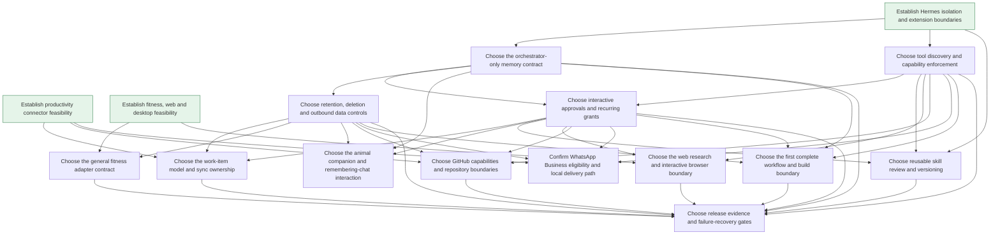

# Decision frontier

This view lists open decision tickets. The map indexes resolved research and standing user requirements; it does not duplicate open ticket bodies.

## Available now

- [Choose the orchestrator-only memory contract](issues/04-memory-contract.md)
- [Choose tool discovery and capability enforcement](issues/05-tool-routing.md)

## Waiting on prerequisites

- [Choose interactive approvals and recurring grants](issues/06-approvals-recurring.md)
- [Choose retention, deletion and outbound data controls](issues/07-data-control.md)
- [Choose the work-item model and sync ownership](issues/08-task-sync.md)
- [Choose the general fitness adapter contract](issues/09-fitness-sdk.md)
- [Choose the animal companion and remembering-chat interaction](issues/10-animal-chat-ux.md)
- [Choose reusable skill review and versioning](issues/11-skills-governance.md)
- [Choose the web research and interactive browser boundary](issues/12-web-vs-browser.md)
- [Choose GitHub capabilities and repository boundaries](issues/13-github-capabilities.md)
- [Confirm WhatsApp Business eligibility and local delivery path](issues/14-whatsapp-onboarding.md)
- [Choose the first complete workflow and build boundary](issues/15-first-slice.md)
- [Choose release evidence and failure-recovery gates](issues/16-release-gates.md)

## Dependency view

Metadata uses local tracker numbers for dependency mechanics; human references use ticket names. Claim one frontier ticket before work. No implementation is authorized by being on this list.
