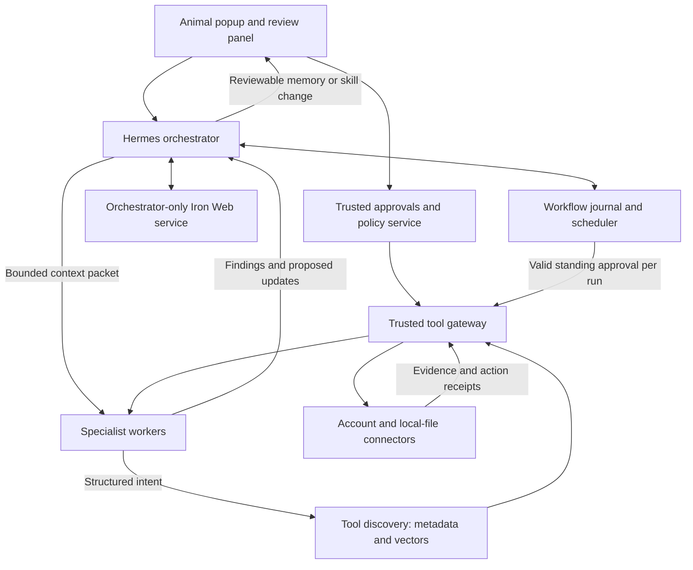

# Iron Web companion: product and architecture plan

Planning date: 24 October 2026, Asia/Calcutta. This is a proposed build plan and decision map, not an implemented integration. No accounts were connected, tasks scheduled, private data read or runtime code changed during planning.

Foundation update: the 30-page **Personal AI Hackathon Foundation Research** report has been read and incorporated. [Integration and source-page traceability](.scratch/iron-web-companion/research/foundation-report-integration.md) records the additions and conflicts. The proposed first hackathon slice is a source-linked research brief with approved remembering, correction and one controlled follow-up; the broader roadmap remains intact.

Delivery view: [Phase-by-phase build and manual test plan](PHASE-BY-PHASE-PLAN.md) defines the small implementation increments, expected manual observations, isolated fixtures and signoff gates. It refines the build order below without silently resolving the open architecture decisions.

## 1. Product definition and confirmed scope

A Windows animal companion that remembers approved information, coordinates specialist agents, turns messages into work items, helps manage notes and calendars, produces weekly fitness summaries, researches the web and works with GitHub. Hermes supplies the agent runtime; Iron Web supplies durable, evidence-backed knowledge.

Confirmed by the user:

- Start on one Windows device with local storage. Online accounts, multi-user deployment and device sync follow later.
- Only the orchestrator accesses the main memory architecture. Workers receive the selected context for their assignment.
- Each new task has a visible plan before tools run, followed by review of concrete changes before execution. Narrowly approved recurring jobs are allowed; their scope must remain enforceable and revocable.
- Retain the animal popup as the interface. **Desktop scanning, screen capture and desktop recording are excluded from this plan.**
- Fitness integration must be general and extensible across applications, rather than hardwired to a particular wearable.
- Persistent memory, reusable skills, independent memory spaces and metadata-based tool discovery are core requirements.

The canonical Wayfinder map is [Iron Web desktop companion and delegated workflows](.scratch/iron-web-companion/map.md). Its child files are decision tickets, not tasks already authorized for implementation. Research findings are resolved; architecture and UI recommendations below remain reviewable until their tickets are settled.

## 2. What we can reuse

Source inspected: `D:\Opencode_\memory_system`.

| Existing component | Reuse | Remaining work |
|---|---|---|
| FalkorDB + embedded Qdrant engine | Sources, semantic retrieval, temporal claims, provenance, corrections | Preserve the engine; expose it only through an authorized orchestrator boundary |
| Saved memory spaces | Independent tests/projects and stable source IDs | Bind ownership to authenticated principals; IDs alone do not authorize access |
| Context compiler and cards | Bounded context and stale-evidence validation | Generalize the retained travel-specific `trip_id` / task contracts using a versioned compatibility path |
| Shared service and SQLite journal | Authenticated tenant/actor identity, receipts, replay, work leases and dependencies | Evaluate extension for workflow/action/approval state; it does not yet provide the complete connector approval broker |
| Nemotron Lightning and Ultra support | Optional model routes for extraction and grounded responses | Add primary-only Hermes adapter, per-task routing and explicit outbound-data policy |
| Memory Testing Workbench | Developer diagnostics and retained test records | Keep it a development tool; its loopback inventory routes are not the worker authorization boundary |

Historical validation from the previous implementation session: 204 tests passed and 21 live isolation checks passed. These counts are prior evidence, not a new application test run on 24 October. See [baseline inspection](.scratch/iron-web-companion/research/iron-web-baseline.md).

## 3. Proposed system boundary



The UI is a client, not another privileged agent. A trusted connector service can hold narrowly scoped account credentials without allowing workers to inspect them. A worker may call an authorized gateway operation, but has no direct Iron Web API, database, memory-file or credential access.

Use one owning process for the embedded memory runtime. Agent concurrency is above that service, not several processes opening the same Qdrant directory. Existing shared-service receipts and work leases are useful starting points, but external action receipts and approval consumption require their own explicit contracts.

Hermes conversation isolation does not establish OS isolation: its children can inherit enabled toolsets, MCP tools and shared workspace access. Restrict the resolved child tool list, external-provider hooks and worker filesystem/network access. Start workers with broker tools only. Later code/shell workers require a separate sandbox with no memory mounts, credential files or direct memory-service networking. [Hermes research](.scratch/iron-web-companion/research/hermes-boundaries.md)

## 4. Agents and feature coverage

Workers are logical roles. The orchestrator creates them when needed; seven permanently running model processes are unnecessary.

| Role / feature | Inputs and outputs | Memory and action boundary |
|---|---|---|
| Work intake worker | Approved Gmail messages and WhatsApp Business events → proposed obligations, deadlines, priorities, source links | No automatic task creation, reply, mailbox mutation or scheduling merely because a message requests it |
| Fitness summary worker | Normalized, permissioned fitness records → deterministic weekly totals and explanatory summary with coverage/gaps | Receives a health-only packet; approved goals and summaries may enter Iron Web; raw time series stay in structured local storage |
| Remembering chatbot | Conversation + selected memory space → grounded answers, corrections and explicit memory proposals | Orchestrator-facing UI; cite memory evidence, preserve missing/disputed states; text first, push-to-talk/spoken replies as a later UI increment |
| Personal planning worker | User requests, selected notes and calendar availability → work-item and schedule proposals | Notion, local notes and Google Calendar are distinct capabilities; review target calendar, dates, timezone and attendee notifications |
| Web research worker | Approved query/URLs → cited findings using Tavily | Search/extract/crawl/map are separately bounded remote operations; private queries and URLs require an allowed egress purpose |
| GitHub worker | Selected repositories → summaries, issue/PR drafts and proposed repository actions | Read, issue creation, comments, branch writes, PR creation, merge, workflow dispatch and settings changes remain distinct operations |
| Skill curator role | Completed, reviewed workflow → reusable skill proposal | No automatic installation or permission expansion; versioned review, tests and rollback |

Official-work and personal-planning roles share a common work-item model and scheduler, while retaining different source accounts, memory scopes and grants. Uncertain assignees or relative deadlines remain proposals with quoted evidence.

## 5. Orchestrator-only persistent memory

Proposed identity hierarchy:

```text
owner identity → device/profile → authorized memory_space_id
                                    └─ workflow_id
                                        └─ task_id / agent_id
                                            └─ context_snapshot_id
```

The server resolves ownership; a model cannot impersonate an owner by supplying an ID. A device/profile routes work without implicitly granting all of the user's spaces. Personal, work, fitness and test knowledge can use separate spaces. Cross-space context needs explicit orchestrator policy and user permission.

A context packet contains the task goal, selected factual values, source/claim IDs, scope, known conflicts, constraints, snapshot/version, expiry and output schema. It contains no memory access token or unrestricted memory-search handle. Workers return findings, source references, proposed changes and unresolved questions.

The orchestrator validates worker results and proposes durable changes. User statements, external message contents, tool observations and model inferences keep distinct provenance and authority. An email or web page cannot redefine a skill or user preference by describing an instruction. Corrections must preserve prior evidence and use the existing lifecycle.

Separate stores by responsibility:

- **Iron Web:** approved knowledge, preferences, decisions, source-backed summaries and corrections.
- **Workflow journal:** task state, leases, approval/grant IDs, checkpoints, external receipts and reconciliation state.
- **Structured application data:** work-item fields, raw imported fitness measurements and connector sync cursors.
- **Temporary worker scratch:** task-lifetime material with explicit cleanup.
- **Skill registry and tool catalog:** reviewed procedures and operation descriptions, versioned independently from personal memory.

Revalidate dependent context before action execution. A corrected deadline or changed source after preview invalidates affected proposals and requests review again. Remote model use remains optional: local storage does not mean prompts sent to NVIDIA stay on the device. Every enabled model route needs a data-class and egress rule.

## 6. Tool metadata, vector discovery and permission

Implement the user's intended matching flow with an authorization boundary:

```text
Worker's requested work
  → validated intent: operation, resource, account, constraints, data class
  → eligibility filter over the reviewed tool catalog
  → vector + lexical retrieval of candidate operations
  → schema/capability checks and clarification for ambiguous/no matches
  → only selected operation schemas exposed to that worker
  → user approval or matching standing grant
  → gateway revalidates actual arguments, identity and current policy
  → execute and store a receipt
```

The intent may be model-produced; its fields are untrusted until validated. Semantic similarity discovers suitable operations. **A high similarity score grants no permission.** Unavailable connections, missing rights, ambiguous accounts or unsupported operations produce a question or denial, never a fallback to a more powerful tool.

Proposed tool metadata:

```json
{
  "tool_id": "tavily.search",
  "version": "1",
  "service": "tavily",
  "capabilities": ["web.search"],
  "description": "Search approved public web sources",
  "input_schema_ref": "schemas/tavily-search-v1.json",
  "output_schema_ref": "schemas/search-results-v1.json",
  "effect": "remote_read",
  "data_classes_allowed": ["public"],
  "resource_constraints": {"domains": "grant-bound"},
  "credential_binding": "gateway-owned",
  "approval_policy": "task_or_matching_standing_grant",
  "cost_and_rate_limits": "grant-bound",
  "retry_policy": "operation-specific",
  "provenance": "reviewed registry entry"
}
```

These are proposed fields, not existing Hermes parameters. Keep the catalog embedding collection separate from personal-memory vectors. Tool descriptions and schema versions are reviewed and hashed. Catalog installation/updates require approval; scraped documents cannot register tools. Record retrieval candidates, selection reasons, policy decisions and executed operation IDs for inspection, without logging secrets.

Hermes already has progressive Tool Search using BM25 and describe/call bridges. Extend that discovery path with vectors and exact capability matching rather than building a second ungoverned executor. Every path—including skills, MCP bridges and scheduled runs—must reach the same gateway. [Hermes Tool Search](https://hermes-agent.nousresearch.com/docs/user-guide/features/tool-search)

Enforce permission inside the gateway handler. Hermes middleware explicitly documents fail-open failure behavior, so a failing middleware callback cannot be the only approval barrier. [Hermes middleware contract](https://hermes-agent.nousresearch.com/docs/developer-guide/middleware)

## 7. Approval and recurring-job contract

Interactive tasks have two review levels:

1. **Task plan:** show the goal, data to read, involved accounts, proposed tools, possible external transmission and expected effects before tools run.
2. **Concrete action:** show the exact proposed change before sending, scheduling, editing files/notes/repositories, promoting memory or installing/updating skills. Preview a diff where useful.

Approval binds owner, space, workflow, selected resources, action/tool version, payload or content digest, destination, current context proof, limits and expiry. It is checked and consumed by trusted code. Model text saying “approved” is not a receipt. Changes in recipient, calendar, repository, payload or scope require a new approval. Reject and edit options are first-class UI controls.

The user allows **narrow standing approvals**, for example: “Every Sunday, read these permitted fitness sources for the previous week, calculate these metrics, and save a local report in this folder; do not email it.” The exact day/time is a future user setting, not a job created by this plan.

A standing grant specifies schedule/timezone, start/end validity, allowed operations, account/resource set, data classes, output destination, maximum calls/cost, retry behavior, permitted memory retention and revocation. Each run revalidates the grant. Changed scope pauses for review. Review history, pause, revoke and stop-all controls are always available. A source-sync grant and a grant to remember a summary are separate unless explicitly combined.

If the user is absent and no matching grant exists, queue a pending approval and perform no operation. Keep broad Hermes cron autoapproval disabled. Approval of a job is narrower than approval of arbitrary commands.

Suggested workflow states: `proposed → awaiting_plan_approval → ready → running → awaiting_action_approval → applying → completed`, with explicit `paused`, `failed`, `cancelled` and `outcome_unknown` states. Persist transitions and lease ownership. If a provider may have committed before a timeout, reconcile receipts/object IDs before any retry. Do not promise exactly-once effects across arbitrary external APIs.

## 8. Connector strategy

| Connector | First implementation boundary | Later extension / gating fact |
|---|---|---|
| Gmail | User-authorized read-only polling; evidence-backed work-item suggestions | Sending, drafts and mailbox writes need distinct approval. Restricted scopes and hosted processing require Google's applicable verification/data-policy review |
| WhatsApp Business | Business account onboarding, validated inbound events and proposed work items | Not arbitrary personal history; public webhook/relay approach is a decision for a local-first client. Verify current business/AI eligibility and messaging rules before production |
| Google Calendar | Availability reads and reviewed events in a chosen/app-created calendar | Review recurrence, timezone, attendees and notifications; reconcile missed updates and expired sync tokens |
| Notion | Explicitly shared pages/data sources for notes and task views | Pin API version/capabilities; reconcile uncertain committed writes; poll locally first where appropriate |
| Notepad/local notes | User-selected saved text/Markdown files or folders, with path allowlist and overwrite preview | Unsaved Notepad tabs are outside the file adapter; no desktop scraping |
| Tavily | Separate search, extract, bounded crawl and map operations | Interactive login/click/form workflows need a separate adapter decision; Tavily is not that browser-control layer |
| GitHub | Selected-repository read access and proposed issues/PRs | Write, merge, Actions and settings capabilities expand only through specific reviewed use cases |
| Fitness providers | Common schema plus app-specific API, mobile-bridge or import adapters | Coverage depends on provider permissions and data availability; adding a provider does not alter core memory or scheduling |

For a local-first release, prefer polling and durable cursors where providers support them. Providers requiring incoming public webhooks need an explicit relay/tunnel/hosted-receiver decision; do not silently expose the Windows service. Check webhook signatures, account binding and duplicate IDs. Periodic reconciliation repairs missed events. [Productivity connector research](.scratch/iron-web-companion/research/productivity-connectors.md)

“GitHub and everything” becomes an extensible connector catalog, not an initial blanket credential. Each new operation needs a manifest, conformance tests, account authorization and approval policy.

## 9. General fitness integration

Build a **fitness adapter SDK**, not a universal account scraper. Every adapter reports:

- Provider identity and version, connection mode (`cloud_oauth`, `mobile_bridge`, `file_import` or `manual_entry`).
- Supported metrics, read permissions, available history, background-sync support, source identifiers and deletion/revocation behavior.
- Normalized records: metric type, value/unit, start/end or observation time, timezone, source/device, original record ID/version and quality/coverage flags.
- Cursor/import identity, rate limits, pagination and update/delete semantics.

Initial common types: daily steps, activity duration, workout sessions and user-defined goals. Add sleep and other metrics only where permission and data semantics are explicit. Maintain original units/provenance and deterministic conversion versions. Aggregate numbers before asking a model to summarize them. Missing records mean unavailable coverage, not zero activity. Avoid double counting overlapping devices/imports.

New providers implement this contract and pass a fixture-driven conformance suite. Unsupported applications can use documented exports or manual entry; show a capability matrix rather than suggesting all metrics are available everywhere. Android Health Connect and Apple HealthKit require an authorized mobile component or suitable export path for Windows use. Vendor cloud access must be verified for the adapter being shipped. [Fitness and platform research](.scratch/iron-web-companion/research/fitness-web-desktop.md)

Weekly output: date range/timezone, sources and available days, measured totals, comparison against the user's stated goals, missing-data notes and source references. Keep fitness summaries descriptive; this feature does not diagnose conditions or prescribe treatment. Separate fitness records from work-email and GitHub contexts. Sending a report elsewhere requires its own approved destination.

## 10. Reusable skills

Keep skills as reviewed, versioned procedures, separate from user facts and tool permissions. A skill declares purpose, input/output contract, required capabilities, data classes, approval checkpoints, validation examples and version/checksum.

Example proposed skills: extract obligations from a message; prepare an evidence-backed calendar proposal; summarize a fitness week; prepare a GitHub issue from supplied evidence.

Lifecycle: completed workflow → candidate procedure → tests and human-readable diff → user approval → published version → monitored use → rollback/revocation. Worker-generated skills remain proposals. Loading a skill never installs new tools, obtains secrets or widens grants. Hermes has skill-write review controls that can support this flow; the gateway remains authoritative. [Hermes skills research](.scratch/iron-web-companion/research/hermes-boundaries.md)

## 11. Animal companion and data control

The popup expands into a readable panel with: Chat, Active memory space, Work/Personal tasks, Weekly fitness, Pending approvals, Running jobs, Skills, Connections and Data controls. The animal can indicate idle, working, waiting for approval and error states. It must support minimize, mute reminders, pause jobs and quit. Approval details use the panel, not a tiny click target on the animal.

Push-to-talk and spoken replies are a proposed later increment; microphone access, speech-engine choice and any remote audio transmission require their own explicit controls. No always-on listening is assumed. No screen scanning/capture is included.

Turn “Absolute Data Control” into inspectable guarantees:

- Local storage locations, connected accounts and active grants are visible.
- Account credentials stay in OS-backed secret storage or the trusted broker, never prompts, packets, skill files or logs.
- Data classes include public, personal, work and fitness-sensitive, with allowed model/tool destinations and explicit redaction/egress decisions.
- Users can inspect sources, correct or forget retained memories, export their data, disconnect a provider and revoke jobs/skills.
- Forgetting tracks source records, vectors, graph claims, derived summaries, caches and indexes; queued workflows depending on forgotten data are paused or invalidated.
- Logs have redaction and retention controls. Backup retention, restore behavior and tombstones must prevent deleted material silently returning after restore. Crypto-erasure requires a key design; it is not assumed from file deletion.
- Local deletion cannot retract a sent message, erase the source account or guarantee deletion of copies already received by an external provider. Display those boundaries and outbound receipts honestly.
- “Pause external access” stops connector/model egress while local inspection remains available. “Stop all” blocks new actions and cancels or records in-flight operations with uncertain outcomes.

Encryption at rest, key recovery and retention defaults are decision tickets. Do not describe local-first as already encrypted or offline when a remote model or connector is used.

## 12. Delivery sequence and exit gates

This is dependency order, not a time estimate or authorization to start implementing.

The stages below group architecture work. Use the [phase-by-phase manual plan](PHASE-BY-PHASE-PLAN.md) as the detailed delivery sequence: it brings Tavily and the research milestone forward and splits connectors into separately testable handoffs.

| Stage | Build focus | Must demonstrate before advancing |
|---|---|---|
| A — Trusted foundation | Pin Hermes; orchestrator-only adapter; identity/space binding; versioned generic context contracts; workflow journal | Workers cannot discover/read/reach memory through direct tools, bridges, files, network or session search; existing spaces and lifecycle tests still work |
| B — Controlled tool execution | Reviewed metadata registry; vector/lexical discovery; gateway; plan/action approvals; narrow recurring grants; sandboxed worker roles | No-match/ambiguous intent stops; denied/expired/revoked/modified grants cause zero external calls; middleware failure cannot bypass checks |
| C — First complete user flow | Animal shell and remembering chat; selected documents → cited research brief → approved decision → fresh-session recall/correction → one permitted follow-up and draft | Source-backed output and approved memory → inspect/correct → next-run/pause status → actual follow-up receipt; decline has no effect; restart does not duplicate an uncertain action |
| D — Productivity breadth | Notion, saved local notes, general scheduler, WhatsApp Business after eligibility/receiver decisions, GitHub operations | Explicit source-of-truth/conflict rules; account separation; cursor recovery; timezone/recurrence tests; operation-specific approvals |
| E — General fitness | Adapter SDK; normalized fixture/import adapter; one representative API/mobile path when available; weekly report worker and standing job | Missing/overlapping/reimported/late data produces correct totals; revoked source/expired job grant stops use; no fitness leakage into work context |
| F — Research, skills and polish | Tavily adapter can be introduced after B; reviewed skill library; optional voice; accessible animal UX and data controls | Cited web findings; bounded crawl/cost/egress; skill update rollback; export/forget/backup-restore verification |

Use controlled connector fixtures and dry runs first, then provider test accounts/sandboxes, then individually authorized real accounts. Use Lightning and Ultra in the same evaluation matrix without encoding either model as the authorization authority. Compare extraction correctness, tool-selection precision, cost/latency and refusal on insufficient evidence.

## 13. Release acceptance matrix

1. **Memory isolation:** different owner/space/task packets; two concurrent jobs; guessed IDs; malicious worker; no direct/broker/session-history escape.
2. **Tool selection:** paraphrases, negation, read-versus-send confusion, low similarity, ambiguous resources, poisoned descriptions, stale registry version and no supported tool.
3. **Approval:** rejected, expired, revoked, replayed, cross-space and payload-modified approvals; absent user; recurring grant boundary changes; plugin/middleware failure.
4. **External consistency:** duplicate/missing events, lost cursors, revoked OAuth, rate limits, failure before commit and timeout after commit; reconcile uncertain outcomes before retry.
5. **Work scheduling:** source edits, disputed date/assignee, timezone and daylight-saving transitions, recurrence exceptions, app restart/offline periods and cancelled jobs.
6. **Fitness:** unit changes, missing days, overlapping devices, duplicate imports, source updates/deletes, reaggregation and privacy/egress blocks.
7. **Persistent knowledge:** raw source versus inference, explicit remember/correct/forget, stale context, restored backups and cross-domain disclosure prevention.
8. **Skills:** unreviewed edits, malicious procedure steps, forbidden capability requests, version rollback and reproducibility on fresh workers.
9. **UI:** visible active space, readable diffs/destinations, approval editing, keyboard access, pause/revoke/quit; no excluded desktop-capture permissions or background components.

Acceptance evidence must include exact inputs, source IDs, selected tools, policy/grant decisions, actual provider/test receipts and outcomes. A pleasant model answer alone does not establish successful execution.

## 14. Decisions to work next

The map's frontier and dependency graph are generated from separate child tickets. The first proposed decision to work is **Choose the orchestrator-only memory contract**; the next is **Choose tool discovery and capability enforcement**. The current plan deliberately does not close those human decisions on the user's behalf.

The main unresolved choices are memory-service ownership and migration, the gateway/worker boundary, approval UX and standing-grant fields, data retention/encryption, task/Notion/Calendar conflict ownership, the fitness adapter contract, WhatsApp eligibility/receiver deployment, the animal/voice prototype, and the first production connector slice. Multi-user and device-sync implementation stays after the local release.

## 15. Foundation report: hackathon delivery overlay

Keep the complete product roadmap, but make the first demonstration coherent: choose a few documents, produce a cited brief, approve a remembered preference or decision, retrieve it in a fresh session, correct it, and schedule one permitted follow-up that produces a real draft with a pause control. Proposed starter skills are paper review, project brief and commitment check. The animal remains the entry point; broad connector coverage and voice should not block this first complete workflow.

Add **Nebius Token Factory** as a distinct inference adapter, with Lightning for routine work and budgeted Ultra for difficult synthesis. Discover exact account-visible IDs and validate a harmless completion, actual structured tool call/result replay, streaming, cancellation and the full memory workflow. Preserve the previous NVIDIA route as a separate configuration; an NVIDIA key or test trace does not establish Nebius access. An inference-disclosure gate previews selected context and records provider/model/purpose/usage without logging secrets. Include auxiliary compression, title and review routes in this control.

Time-box a pinned Hermes/NemoClaw/OpenShell compatibility trial before adopting a managed sandbox. Verify real egress denial and allowed tools, private memory reachability and restart behavior. Preserve Windows/local first; use a compatible WSL2/Linux runtime only after validation and approval. A simpler restricted Hermes runtime remains the delivery fallback. Existing `ops` scripts are operational context, not proof that this update installed or certified the stack.

Extend scheduler acceptance to persistent occurrences, leases, missed-run handling, cancel acknowledgement, next/last-run display, heartbeat and meaningful-change notifications. State the availability promise accurately: a sleeping Windows device is not always available. Use one scheduler per routine and keep durable memory independent of disposable compute. Test backup restore with both corrected and forgotten facts; no silent resurrection through indexes or caches.

Expand evaluation to a proposed 30-case synthetic suite split across memory/correction, tool use and research synthesis. Compare both models on identical evidence and permissions; measure source correctness, stale answers, unauthorized operations, tool turns, latency and cost per successful task. Record pinning, setup, real routing traces and failed/unsupported/not-tested outcomes. These are future gates, not new passing results.

Prepare a separate synthetic demonstration environment, licensed public source and setup instructions, third-party notices, a clear statement of additions to existing memory code, an under-three-minute public video and a judge-access/recovery runbook. Official rules currently display 30 October 2026 at 10:00 PDT (22:30 India time); use an earlier internal cutoff and recheck before submission. Current rules require qualifying Nebius runtime use plus an NVIDIA open model. No entry, deployment, spend or public publication is performed by incorporating this report. [Official rules](https://nebiusglobalaihackathon.devpost.com/rules)

One architectural conflict stays open: the PDF's journal-as-authority proposal differs from existing Iron Web's graph/vector implementation. Preserve the working architecture until the memory-contract decision establishes retention versus a tested migration. Automatic provider hooks similarly remain optional after explicit orchestrator-only memory operations are proven.
