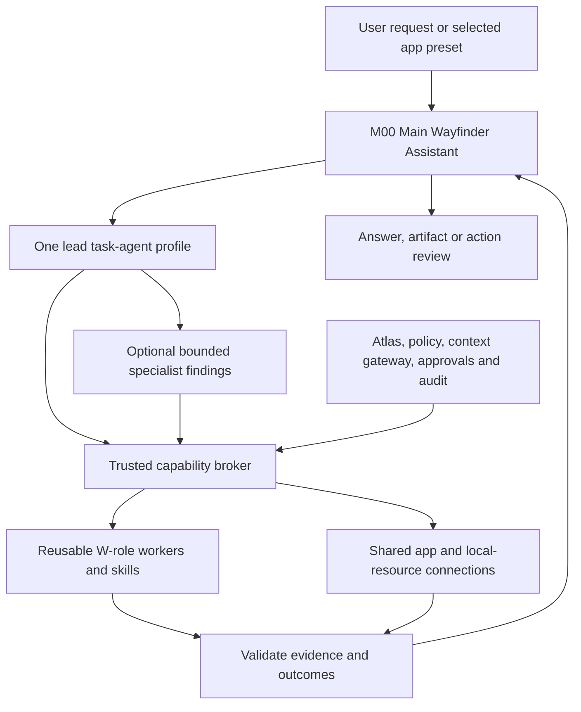

# Wayfinder: consolidated agents, apps and integration plan

Research date: **26 October 2026**. Status: proposed architecture and implementation order. This consolidates the earlier task-agent plan and the subsequent Google/Gmail/Notion discussion. It does not mark the profiles or proposed connections as implemented.

## 1. Recommended system

Build **one main Wayfinder assistant**, **eight task-agent profiles**, and **six app-focused presets** over the same runtime, atomic workers, skills and tools. Fitness remains deferred.

The six app presets are named ways to specialize the task profiles. They are not six additional always-running services or a second implementation of the same tools. A request starts only the lead and helpers it needs. All eligible profiles can share capabilities; the user's task and grants determine actual access.

Use Hermes for model execution, existing delegation and skills; OpenShell/NemoClaw for the managed execution environment; Atlas for discovery; Iron Web for approved persistent memory; and the trusted Wayfinder services for resource access, approvals, receipts, reconciliation and audit. Add missing integration, not another agent framework, scheduler or memory engine.

## 2. What the research establishes

The following are public product behavior and published implementation patterns. Wayfinder's architecture below is a recommendation inferred from them, not a claim about private internals or automatic compatibility.

| Published source | Finding | Design implication |
|---|---|---|
| [OpenAI agent guide](https://openai.com/business/guides-and-resources/a-practical-guide-to-building-ai-agents/) | Describes a manager calling specialists as tools and reusable tools with many-to-many agent relationships. | Keep a single conversation owner and share tool implementations across profiles. |
| [ChatGPT connected apps](https://help.openai.com/en/articles/11487775-connected-apps-in-chatgpt) | Apps expose information and supported actions inside a conversation; connecting an account remains separate from installing an app. | Separate agent identity, connector installation, account authorization and operation availability. |
| [Gemini Workspace connection](https://support.google.com/gemini/answer/15229592) | One Workspace connection can support questions and tasks involving multiple Google services. | Offer a Google Workspace preset for cross-app outcomes without treating Google as one universal API. |
| [Anthropic Research engineering](https://www.anthropic.com/research/multi-agent-research-system) | A lead delegates bounded independent investigations. Parallel work has coordination and token costs. | Use parallelism for independent work and compare against a simpler baseline. |
| [Claude Code subagents](https://code.claude.com/docs/en/sub-agents) | Specialists have their own context, instructions, tools and permissions. | Isolate noisy research, reviews and logs; pass relevant context and return compact evidence. |
| [Copilot custom agents](https://docs.github.com/en/copilot/concepts/customizations/custom-agents) | A specialist definition and a delegated subagent run are distinct concepts. | Define reusable profiles and instantiate them on demand, directly or as helpers. |
| [Hermes delegation](https://hermes-agent.nousresearch.com/docs/user-guide/features/delegation) | Native delegation supports isolated conversations; documented tool inheritance and optional routing affect permissions. | Reuse Hermes, but verify resolved tool access and installed routing before activation. |

The research supports a small set of outcome-oriented agents, reusable app presets and a common controlled tool layer. It does not justify starting every agent for every question.

## 3. Main assistant and task agents

**M00 — Main Wayfinder Assistant** owns the conversation. It understands the goal, picks a lead profile, resolves missing constraints, obtains context through trusted services, tracks completion and presents a coherent result. A simple question or explicit memory correction can use an existing handler directly.

| ID | Agent | Complete user task it owns | Typical shared connections | Reusable atomic responsibilities |
|---|---|---|---|---|
| **A01** | **Research & Verification** | Research alternatives, verify evidence, compare trade-offs and recommend an option for stated requirements. | Web/Tavily, selected files, Notion, selected Drive files, GitHub for technical research, scoped memory context. | W08–W12, W19/W20 as appropriate. |
| **A02** | **Planning & Productivity** | Build a realistic day/week/project plan, identify conflicts, prepare meetings and propose task/calendar/reminder changes. | Calendar, Tasks, Gmail, Notion, selected project/repository context, memory, existing scheduling. | W13–W18, W39; helper findings from other profiles. |
| **A03** | **Communications** | Understand selected conversations, extract commitments, prepare reviewed replies and execute specifically authorized sends when supported. | Gmail initially; Calendar/Tasks/Notion/files when relevant; additional messaging providers only when chosen. | W16, W29–W32; W13/W14 for scheduling. |
| **A04** | **Software Development** | Investigate a repository task, plan changes, implement within a granted workspace, run tests, review and prepare Git/PR work. | Local repository, Git/GitHub, scoped code/test execution, official documentation/web, selected Notion/Google project documents. | W19–W25, W43/W45; W08/W09 for documentation evidence. |
| **A05** | **Knowledge & Learning** | Turn selected documents/notes/data into explanations, study guides, comparisons, structured notes or reports. | Notion, Drive/Docs/Sheets, selected local files, web research and relevant memory context. | W08–W12, W34/W35, W39 when relevant. |
| **A06** | **Files & Desktop** | Find and understand authorized local files, prepare local changes and carry out approved desktop actions when the driver is qualified. | File broker/readers; explicitly shared images; future qualified desktop driver; web only when the task needs it. | W33–W37, with W10/W11 for documents/data. |
| **A07** | **Memory & Personalization** | Explain remembered context, interpret preferences, propose corrections and clarify conflicts or scoped maintenance. | Orchestrator-only Iron Web gateway and existing approved memory-change services; selected evidence from other connections. | W02, W38–W42. |
| **A08** | **Fitness & Habits — deferred** | Summarize authorized activity, compare goals/trends and propose routines that fit actual constraints. | Chosen fitness source later, canonical local activity format, selected Calendar/preferences. | W26–W28, W13–W15, W39. |

Common W01–W07 intake/planning/validation responsibilities and W43–W47 diagnostic/recovery/audit/evaluation responsibilities are reused when needed. Deterministic permission checks, approvals, audit and retry limits remain services. No profile is required to instantiate every listed W-role.

Examples of complete deliverables include a cited recommendation, a feasible weekly plan, reviewed reply drafts, a tested code diff, a source-linked study guide or an independently verified approved change. A tool-call transcript alone is not completion.

## 4. App-focused agents/presets

These names can be selected explicitly or resolved from the request. They compose the task profiles above and may use other relevant tools within the task's permissions.

| ID | User-visible preset | Typical request | Underlying profiles and connections |
|---|---|---|---|
| **P01** | **Google Workspace Assistant** | “Prepare for tomorrow using my calendar, emails and selected project documents.” | A02/A03/A05, with Calendar, Tasks, Gmail and separately authorized Drive/Docs/Sheets. |
| **P02** | **Gmail Assistant** | “Find requests in these threads, draft replies and identify deadlines.” | A03 as lead; A02 for commitments/scheduling; selected files and knowledge context as needed. |
| **P03** | **Calendar & Tasks Assistant** | “Reschedule unfinished work and prepare a workable agenda.” | A02 as lead; Calendar/Tasks; existing Hermes scheduling for actual reminder workflows; A03 for authorized communication context. |
| **P04** | **Notion Workspace Assistant** | “Organize these project notes and draft a project hub.” | A05/A02; Notion search/read/query and qualified reviewed writes; Research, selected documents or GitHub when relevant. |
| **P05** | **GitHub Project Assistant** | “Review this repository's issues and PRs, then prepare a change.” | A04 as lead; GitHub/local Git; A01 for documentation research and A02 for project priorities. |
| **P06** | **Drive, Docs & Sheets Assistant** | “Find the selected brief, explain the spreadsheet and draft a report.” | A05/A01; scoped Drive discovery, Docs/Sheets operations and selected local data; A02 when planning is needed. |

Research/Tavily, Local Files/Desktop and Memory already have natural task-agent entry points A01, A06 and A07, so additional identical presets add little value. Google Slides, Contacts, Keep, Meet or other Google services can be attached later for a demonstrated workflow; the Workspace name does not authorize every Google service.

Slack, Telegram and WhatsApp are future connector choices under Communications, not part of the initial enabled set. WhatsApp would require a supported, authorized integration; its official developer hub concerns the Business Platform, and does not establish personal-account access. [WhatsApp developer hub](https://whatsappbusiness.com/developers/developer-hub/). No such channel is being connected by this plan.

## 5. Shared execution model

The logical layers need not be separate nested model runs. A selected profile can configure the lead Hermes run, which invokes bounded leaf workers only when useful. Mixed tasks have one lead based on the final deliverable. Helpers return assigned findings; they do not independently change the goal or request broader permissions.

Every agent can be eligible for a relevant tool, and a tool can support many agents. Actual exposure for a run requires installed availability, profile eligibility, task purpose and resource grants. Effects additionally require any applicable exact-action approval. A preset changes the focus of the task, not the authenticated owner or the provider permissions.

Memory access stays with the trusted main orchestrator. Worker context requests are resolved by that gateway into bounded evidence; workers receive no Iron Web credentials or unrestricted storage access. Notion pages and Google documents remain source documents, not a second canonical preference/memory engine.

## 6. Connector decisions and research findings

### Google Calendar, Tasks and Gmail

The existing read adapters and private OAuth setup remain the first implementation path. As of the local check for this plan, the real client JSON and token are absent. Start with the selected three read scopes and the existing exact-resource grants, then qualify bounded reads through the authenticated API. Google documents desktop authorization and library-based token handling. [Desktop OAuth](https://developers.google.com/identity/protocols/oauth2/native-app).

New research also found **official Google Workspace remote MCP servers in developer preview**. Assess preview eligibility, Hermes transport/auth support and the actual tool schemas before choosing one for an operation. The documented product/tool list is not proof of Google Tasks support or Gmail sending support; keep the REST route for operations not demonstrated by the selected MCP server. Existing desktop REST consent does not automatically configure a remote MCP client. [Google Workspace MCP](https://developers.google.com/workspace/guides/configure-mcp-servers).

For a future MCP route, Google's release notes require agentic OAuth client configuration and announce enforcement starting **11 November 2026**. This is a specific MCP setup dependency; do not silently replace the present REST connection or assume one OAuth setup covers both transports. Recheck the requirement before enabling that route. [Google Workspace release notes](https://developers.google.com/workspace/release-notes?hl=en).

For Gmail, separate reference discovery, selected header/body/thread reading, in-app draft generation and sending. The present adapter only covers references. Google's scopes distinguish read, metadata, draft management and sending; the chosen `gmail.readonly` scope does not enable send. Prefer in-app drafts first, adding `gmail.send` only for the approved send feature; creating Gmail drafts requires its own suitable scope. [Gmail scopes](https://developers.google.com/workspace/gmail/api/auth/scopes), [messages.send](https://developers.google.com/workspace/gmail/api/reference/rest/v1/users.messages/send).

Calendar writes must bind calendar, timezone, dates, recurrence, attendees and notification behavior. Calendar supports ETag conditional modification for updates/deletes, while inserts have different resource-ID semantics. Use the documented provider mechanism rather than a read-then-write check presented as atomic. [Calendar versions](https://developers.google.com/calendar/api/guides/version-resources). Task creation also needs write authorization beyond the existing Tasks read scope. [Tasks insert](https://developers.google.com/workspace/tasks/reference/rest/v1/tasks/insert).

### Notion

First reuse and assess the existing adapter. It currently pins `2022-06-28` and reads a single block-response page. The current official version examples use **2026-03-11**; the 2025 data-source change also affects database integration. Add compatibility tests and an explicit migration plan instead of merely changing the version header. Add bounded pagination/nested-content handling and honest truncation. [Notion versioning](https://developers.notion.com/reference/versioning), [data-source upgrade guide](https://developers.notion.com/guides/get-started/upgrade-guide-2025-09-03).

Evaluate **Notion's official hosted MCP** through Hermes before building new general Notion capabilities. It uses OAuth and can expose read/write tools. Prefer it when the installed client, user's account, selected operations and resource boundaries qualify; otherwise adapt the existing API connection. Choose one canonical handler per operation so two routes do not duplicate an effect. [Notion MCP](https://developers.notion.com/guides/mcp/overview).

Notion's supported-tools documentation says unavailable filters can be dropped with notices. Search filters are not an authorization boundary. Inspect capability availability before requesting constrained search, enforce provider-side content access and exact resource grants, and refuse an unavailable required constraint. Do not quietly broaden the task or search Notion-connected mail/Slack/Drive sources. [Supported tools](https://developers.notion.com/guides/mcp/mcp-supported-tools).

Expose only selected operations through the broker. Optional Notion memory/calendar/connected-source tools do not become Wayfinder defaults simply because the MCP server offers them. Treat returned content as source data and route changes through review. [Notion MCP security guidance](https://developers.notion.com/guides/mcp/mcp-security-best-practices).

### GitHub and software development

Qualify GitHub's official MCP server in read-only mode with selected tools/repositories, or use the corresponding official API/SDK where a necessary operation is not suitably exposed. A GitHub App is the preferred product authorization option to evaluate for repository-specific, fine-grained access; a narrowly scoped development credential can be a temporary local choice. Neither a Codex account connection nor local Git proves that the Wayfinder product is connected. [Official GitHub MCP](https://github.com/github/github-mcp-server), [GitHub App versus OAuth](https://docs.github.com/en/apps/oauth-apps/building-oauth-apps/differences-between-github-apps-and-oauth-apps).

Enable repository/issue/PR/check reads before writes. Qualify issue creation, comments, branch/commit operations, PR creation and merge separately. Workflow dispatch, deployment, repository settings and secret management are distinct effects, not implied by a development task. Existing local Git qualification covers only one bounded new-branch operation.

Coding must use an approved workspace with explicit editing/test capabilities, one writer per shared checkout, cancellation and actual test evidence. Reuse the existing managed sandbox/runtime; raw terminal access is not a substitute for scoped operation handlers. A reviewer may supply advisory findings, but cannot approve or widen execution rights.

### Drive, Docs and Sheets

These need separately selected APIs/scopes and their own operation qualification. Prefer user-selected files. Google describes `drive.file` as per-file access for files used/shared with the app, whereas broader read scopes have different coverage. Its name does not make it read-only: Wayfinder must still expose and authorize read/write operations separately. Evaluate official MCP support where available; reuse official APIs for gaps. [Drive scopes](https://developers.google.com/workspace/drive/api/guides/api-specific-auth).

Support document/spreadsheet revision checks where the chosen provider operation offers them. A spreadsheet change must bind the exact document/tab/range and values; document updates bind the selected document and proposed changes. File sharing, permissions changes and deletion stay separate from content editing.

### Web, local files, scheduling, memory and desktop

Reuse the existing Tavily tools/skills. Official Tavily MCP exposes search, extract, crawl, map and research, but switching transport is optional and needs qualification; it does not justify installing a duplicate search stack. Bound retrieval and preserve source URLs, dates and uncertainty. [Tavily MCP](https://docs.tavily.com/documentation/mcp).

Reuse FileBroker grants/readers, the existing isolated Hermes jobs, Iron Web APIs, ActionGate patterns and audit/recovery state. Reuse existing Hermes scheduling for reminders after the relevant interface is qualified. Keep model token/cost values unknown when the provider does not report them.

Local file functions can be delivered while **W37 remains disconnected**. Do not launch Cedar, capture the screen, inspect the clipboard or replay a prior uncertain desktop attempt. Native testing needs the user's explicit re-enablement. Fitness remains outside the initial implementation.

## 7. Connection inventory and current status

| Connection | Initial capability | Current evidence | Next qualification gate |
|---|---|---|---|
| Google Calendar | Bounded event reads | Adapter/fixture tests and OAuth helper prepared | User client/consent, then scoped real reads; analysis and writes later. |
| Google Tasks | Bounded default/selected-list reads | Adapter/fixture tests prepared | Consent/live reads, then separately qualified task changes. |
| Gmail | Selected label message references | Adapter/fixture tests prepared | Consent/live reads, selected content/thread reader, reviewed drafts, explicit sends later. |
| Notion | Selected page search/read | Existing legacy adapter and historical verification | Connection/version/scope review, safe bounded content reads and action-gated writes. No live Notion pass is asserted by this research. |
| GitHub | Selected repository/issue/PR/check reads | Registry and development-role contracts; local Git is separate | Product account authorization and selected read-only API/MCP tools. |
| Google Drive | Selected file discovery/reading | Planned integration; registry metadata does not qualify it | Per-file account/resource permissions and live read proof. |
| Google Docs | Selected document reading, later reviewed edits | Planned integration | Account/file grant, bounded content/revision verification. |
| Google Sheets | Selected ranges and checked calculations | Planned integration | Account/range grant, typed values, later exact reviewed writes. |
| Web/Tavily | Search/extraction and source verification | Existing CLI/skills/metadata | Task-profile integration and reproducible scoped live cases. |
| Local files | Discovery and analysis | Existing tested W34/W35 implementation | Reuse it in the first task-agent demonstration. |
| Iron Web | Scoped context and approved change events | Existing platform integration and synthetic storage tests | Preserve its scope/freshness rules across task-profile boundaries. |
| Hermes runtime/delegation | Lead/worker execution | Installed 0.21.3 and previously inspected native task schema | Profile execution, child tool isolation and cancellation qualification. |
| Hermes scheduling | Approved reminders/recurrence | Module presence, not integrated reminder proof | Explicit reminder-role/reuse mapping and scheduling lifecycle tests. |
| Desktop driver | Exact approved native actions | Partial fixture connection; successful native completion unverified | Remains disabled pending explicit re-enablement and qualification. |
| Fitness provider | Activity/trend data | Canonical local CSV foundation only | Deferred; choose a provider/source later. |

Readiness is per operation, account and resource class. “Connected,” “registered,” “fixture-tested,” “live-read-tested” and “write-qualified” must not be shown as interchangeable states.

## 8. Runtime and authority rules

Previously inspected Hermes 0.21.3 exposes `delegate_task` with task goal/context/structured-output fields. Named profile routing was not demonstrated in the installed exposed schema. Current Hermes documentation describes optional advanced delegation, but documented availability is not installed availability. Check the official plugin and effective child tools before enabling it. Retain the existing bounded host-controlled Hermes SDK jobs if a proposed delegation route cannot enforce the required scopes. [Hermes delegation](https://hermes-agent.nousresearch.com/docs/user-guide/features/delegation).

Hermes profiles may have independent memory/configuration. Wayfinder task profiles must not introduce competing persistent personal memories: keep canonical facts/preferences in Iron Web and keep worker contexts isolated. Separate runtime/session files are not a second semantic memory store. [Hermes profiles](https://hermes-agent.nousresearch.com/docs/user-guide/profiles).

MCP is a transport/tool protocol with authorization mechanisms, not Wayfinder's business-policy engine. The host must still constrain tools, scopes, effects and credentials. Do not forward the application bearer or reuse a token for a different service/audience. [MCP authorization](https://modelcontextprotocol.io/specification/2026-07-28/basic/authorization).

Proposed initial execution policy:

- One lead task profile; no mandatory specialist call for a simple answer.
- At most two concurrent reasoning leaf jobs and one initial delegation level; raise these only with measured benefit and passing isolation tests.
- Profiles declare eligible tools, skills, worker references, output contracts, budgets and stop conditions. The broker resolves actual tools and grants at run creation and revalidates at access/effect boundaries.
- Provider credentials remain in trusted hosts/adapters. Workers receive bounded context and broker-bound operations, not unrestricted account or Iron Web clients.
- Independent reads may run concurrently. Serialize writes to a shared target and preserve parent/child cancellation and attribution.
- Existing authorization persists within its exact scope. New or changed effects follow the relevant review rules; a source document or incoming email cannot grant permission.
- Bind action approval to account/resource, ordered operations, exact content/parameters, source versions, side effects such as invitations, scope and lifetime.
- Verify provider outcomes and retain explicit uncertainty. Reconcile lost acknowledgements before retrying; do not infer provider idempotency or exactly-once effects from a local request ID.
- Prefer creating drafts/artifacts and additive operations as the first write cases. Do not claim an atomic conditional update where a provider offers only read-then-write checks.
- Skill improvements are proposals through the existing skill system, with versioned review/testing before activation; no automatic tool installation or privilege expansion.

## 9. User outcomes that demonstrate the whole system

| Scenario | Lead and helpers | Required result |
|---|---|---|
| “Prepare me for tomorrow's meeting.” | Workspace preset; Planning lead; Communications and Knowledge helpers. | Agenda, selected correspondence, relevant Notion/doc links, outstanding tasks and explicit gaps. |
| “Research this topic and prepare a Notion project page.” | Research lead; Knowledge/Notion preset for structure. | Cited findings plus an exact proposed Notion page. Creation only after the applicable authorization. |
| “Plan my week from my deadlines and project issues.” | Planning lead; Gmail/Tasks/Calendar and selected GitHub findings. | Feasible timezone-aware plan, conflicts/uncertainties, then independently verified approved changes. |
| “Fix this bug and prepare a PR.” | Development lead; Research for missing documentation and independent review when useful. | Scoped diff, actual tests, review findings and proposed branch/PR actions; no invented test results. |
| “Create a study guide from these files.” | Knowledge lead; existing discovery/document analysis; Research only when needed. | Source-linked guide and examples, with partial extraction/missing evidence retained. |
| “Correct that preference and show conflicting memories.” | Direct memory service or Memory profile for complex analysis. | Relevant evidence and exact reviewed correction, with preserved history and verified publication. |

These are target acceptance scenarios, not claims that their complete cross-app workflows currently run.

## 10. Implementation order

1. **Integrate the worker foundations.** Reconcile `codex/ui-backend-integration` definitions/schemas with this branch's existing desktop/platform package. Preserve dirty work, existing contracts and all permission handlers; integration is an explicit implementation step, not performed by this plan.
2. **Add the task-profile layer.** Define M00, A01–A08 and P01–P06 as versioned manifests/routing presets. Keep Fitness unavailable. Require explicit adapters to worker-owned contracts and reject unresolved tools rather than silently broadening access.
3. **Deliver the first complete user task.** Knowledge & Learning over the proven selected-file path, then Research over supplied/synthetic sources and qualified live retrieval. Compare a direct/single-lead baseline before adding leaf workers.
4. **Complete selected Google reads and Notion reads.** The user completes Google client/consent and selects Notion content. Add bounded Gmail content reading. Qualify stable API paths first; evaluate official MCP routes separately, with preview/account/version constraints.
5. **Enable productivity and app-focused presets.** Demonstrate read-only meeting preparation and weekly planning with source-linked results. Gmail, Calendar/Tasks, Notion and Workspace presets reuse the same handlers.
6. **Qualify one write per provider.** Start with an explicitly reviewed test task/event/page or an approved test email. Verify exact parameters, scopes, side effects, receipts, expiry, revocation, stale state and lost acknowledgements. No sends are authorized by this planning request.
7. **Complete Development/GitHub.** Qualify selected repository reads, restricted editing/tests, review and individual GitHub actions. Enable Drive/Docs/Sheets as concrete file workflows require them.
8. **Expose Memory/Desktop task profiles fully.** Reuse already tested memory and local file services. Keep native W37 execution disabled until separately authorized. Add reminders through existing Hermes scheduling once its lifecycle is proven.
9. **Add optional channels and Fitness later.** Only after source selection and demonstrated needs. No speculative account setup or new permanent agent fleet.

## 11. Evaluation and release criteria

For every enabled profile/preset, test a complete normal task, incomplete/missing evidence, and a bounded failure/recovery case. Test tool sharing explicitly: the same file/calendar capability must work for different profiles while cross-task and cross-owner grants remain unusable.

Shared negative cases include source instruction injection, unauthorized tool requests, dropped provider constraints, missing accounts, stale documents/context, changed payloads, grant revocation, cancellation, deadline/iteration budgets, duplicate deliveries, restart and unknown effects. Run independent read, fixture, live-provider and native-desktop tiers; never substitute one tier for another.

Measure outcome completion, source support, correct tool/resource selection, unnecessary delegation, latency, actual usage/cost where returned, human interventions and uncertain/duplicate effects. Unknown cost is unknown, not zero. Passing an output schema is not proof that a worker performed the claimed work.

Use synthetic/disposable data before user-approved live cases. Keep tests away from destructive changes to live Iron Web, user repositories and personal account data. Version profile/skill/tool-schema bindings so a successful run can be reproduced and permission changes can be reviewed.

## 12. Human input and current limits

Immediate: the selected Google services still need the user's Desktop OAuth client file and consent; see [Google setup](GOOGLE-SETUP.md). Notion needs a chosen connection method/workspace and selected pages/data sources. GitHub needs selected repositories and product authorization. Additional Google file services need file/account selection and appropriate scopes when implemented.

The user does not need to choose W-workers, provide API secrets in chat, manually perform code integration or approve routine unchanged operations repeatedly. Human involvement is for account consent, unavailable provider/account decisions, and actions whose scope requires approval.

This research changed documentation only. It did not merge branches, activate profiles, install MCP/delegation servers, connect accounts, change OAuth scopes, send messages or perform desktop actions. The earlier [worker catalogue audit](WORKER-CATALOGUE-AUDIT.md), [platform results](RESULTS.md) and operation-specific evidence remain separate from this target architecture.
