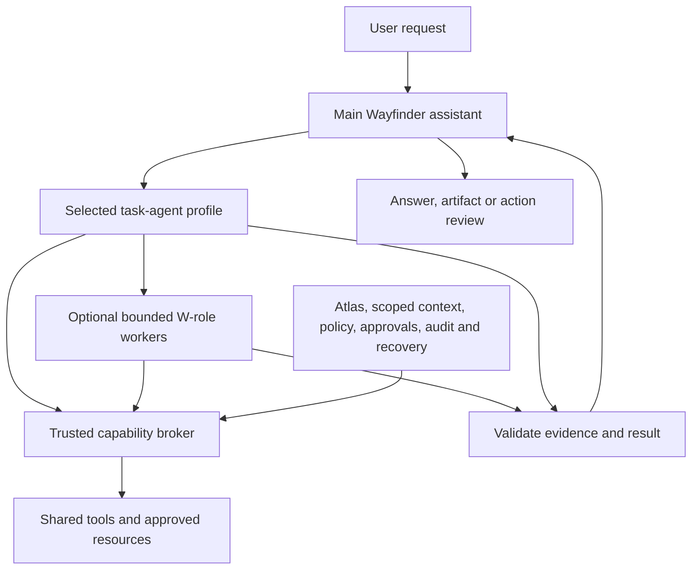

# Wayfinder task agents: research and implementation plan

Date: 26 October 2026. Status: proposed architecture and build sequence, not activated agent profiles.

The subsequent [consolidated agents and apps plan](CONSOLIDATED-AGENT-PLAN.md) adds the six app-focused presets, connector research/qualification decisions and a unified build sequence. Use it as the current design reference; this document retains the original eight-profile proposal.

## Decision

Use **one main Wayfinder assistant and eight reusable task-agent profiles**, with Fitness deferred. A profile defines a useful kind of work; a run receives a particular user goal, context, resources and completion criteria. Profiles run on demand. They are not eight permanent model processes, and a simple request need not start a specialist.

Keep W01–W47 as a reusable catalogue of lower-level responsibilities. Some are reasoning workers, some are skills, and some are deterministic platform services. An agent can call tools directly or use a bounded worker when separate context or specialist reasoning helps. There is no mandatory worker for every step and no requirement to finish every W-role before building the first useful task agent.

Tools have **many-to-many relationships with agents**. A document reader can support research, planning, coding, communications and learning. Any profile can become eligible for a tool when the task requires it; tool ownership is not exclusive. The trusted platform still resolves the actual tool, task scope, source permissions and approval before a call.

## What published assistant designs show

These are lessons from public engineering accounts and official documentation. They do not establish undisclosed internals of every assistant or prove compatibility with Wayfinder's installed runtime.

| Source | Published behavior | Application to Wayfinder |
|---|---|---|
| OpenAI agent guide | Describes a central manager calling specialists as tools, handoffs as another pattern, and reusable tools shared between agents. | Keep one conversation owner; choose task specialists behind it and share capability implementations. |
| Anthropic Research | Describes a lead research agent delegating independent searches, with clear objectives, outputs and boundaries. Reports substantial coordination/token costs. | Parallelize independent research selectively; avoid delegating every small operation. |
| Claude Code | Custom subagents have separate context, instructions, tools and permissions. | Isolate noisy research, logs and reviews; return bounded findings to the task owner. |
| GitHub Copilot | Custom profiles describe reusable specialists; running one as a subagent is a separate execution choice. | Separate profile definitions from individual runs, and allow direct use or delegation. |
| LangChain Deep Agents | Uses subagents for context isolation and specialist instructions. | Keep large intermediate artifacts out of the main conversation. Reuse the pattern without adding another runtime. |
| Hermes | Documents native delegation and optional profile-routing strategies. | Reuse Hermes execution/delegation after checking installed features and resolved permissions. |

Primary sources: [OpenAI practical agent guide](https://openai.com/business/guides-and-resources/a-practical-guide-to-building-ai-agents/), [Anthropic Research engineering account](https://www.anthropic.com/research/multi-agent-research-system), [Claude Code subagents](https://code.claude.com/docs/en/sub-agents), [Copilot custom agents](https://docs.github.com/en/copilot/concepts/customizations/custom-agents), [Deep Agents subagents](https://docs.langchain.com/oss/python/deepagents/subagents), [Hermes delegation](https://hermes-agent.nousresearch.com/docs/user-guide/features/delegation).

Anthropic also recommends choosing the simplest adequate pattern before adding agent complexity. That supports starting with a few demonstrated workflows and adding specialists when evaluation shows a benefit. [Building effective agents](https://www.anthropic.com/research/building-effective-agents).

## Proposed task-agent catalogue

The W-role lists below show reusable responsibilities, not separate mandatory model calls. All profiles can also use common intake, planning, validation, audit and recovery services.

| Profile | User request it owns | Deliverable | Main reusable W-roles |
|---|---|---|---|
| **A01 Research & Verification** | “Research these alternatives and recommend one for my requirements.” | Cited comparison, calculations where needed, evidence quality and unresolved questions. | W08–W12; W19/W20 when the subject is technical. |
| **A02 Planning & Productivity** | “Plan my week around college, project deadlines and existing commitments.” | Feasible agenda, conflicts, priorities and exact proposed calendar/task/reminder changes. | W13–W18, W16, W39; request research or development findings when useful. |
| **A03 Communications** | “Review these emails, identify what I owe people and draft replies.” | Source-linked commitments, reviewed drafts, and separately approved dispatch results when that connector is qualified. | W16, W29–W32; W13/W14 for scheduling commitments. |
| **A04 Software Development** | “Investigate this bug, fix it in the selected repository and verify the change.” | Repository findings, implementation plan, bounded diff, test evidence, review and proposed Git/PR operations. | W19–W25, W08/W09/W20, W43/W45. |
| **A05 Knowledge & Learning** | “Turn these notes and documents into a clear study guide with examples.” | Source-linked explanation, document/data analysis, study materials or a structured note draft. | W08–W12, W34/W35, W39 when relevant preferences were supplied. |
| **A06 Files & Desktop** | “Find the files for this project, explain them and prepare this local action.” | Selected file references, findings, exact local-action proposal and verified outcome when execution is available. | W33–W37; W10/W11 for document/data work. |
| **A07 Memory & Personalization** | “What do you remember about this project? Correct that preference and show conflicting records.” | Grounded recall, preference constraints, reviewed memory changes, conflict explanations and scoped maintenance proposals. | W02, W38–W42. |
| **A08 Fitness & Habits — deferred** | “Summarize my activity and draft a realistic routine around my schedule.” | Coverage-aware trends, goal comparisons and a routine proposal based on actual records. | W26–W28, W13–W15, W39. |

The main **Wayfinder assistant** owns the user conversation, resolves the requested outcome, chooses a lead task profile, requests clarification only when needed, and presents the final result. It can answer simple questions directly. For example, a straightforward preference correction can go directly through the existing memory preview/approval interface instead of creating an unnecessary second model conversation.

## Composition and runtime structure

This is a logical composition, not a requirement for three nested model processes. Initially a selected task profile can configure the lead Hermes run, with bounded leaf workers below it. Routing and final presentation can stay in the main application. A specialist-to-specialist request goes through the controller, which preserves the same user goal and scope; workers do not form an unrestricted peer messaging mesh.

For mixed requests, choose one lead based on the final deliverable. A planning request can ask the Communications profile for commitment findings and the Development profile for repository priorities. Each helper receives a bounded subtask and returns evidence rather than taking over the conversation. The lead remains responsible for omissions, contradictions and completion.

## Shared tools without duplicated integrations

The table gives typical uses, not exclusive ownership or current availability guarantees.

| Shared capability | Example profiles sharing it | Resource/effect boundary |
|---|---|---|
| Web search and retrieval | Research, Development, Knowledge, Planning, Communications when requested | Purpose-bound queries and bounded retrieval; private content is not automatically sent to search providers. |
| File discovery and readers | Research, Knowledge, Development, Desktop, Communications for selected attachments | Existing expiring file grants and opaque references. |
| Structured-data operations | Research, Knowledge, Planning, Development, Fitness | Authorized inputs, checked units/calculations and evidence; code execution needs a qualified sandbox. |
| Google Calendar/Tasks reads | Planning, Communications, Development for selected project scheduling, Fitness later | Exact account resource, time window, task scope and read limits. |
| Gmail reads | Communications, Planning, Knowledge or Development when selected mail is relevant | Selected labels/messages and explicit content scope. The present adapter only lists references; body/thread reading still needs implementation and qualification. |
| Repository and Git operations | Development, Research for source inspection, Planning for project status | Repository grants; read and write are distinct. Current qualified write is only a new local branch. |
| Memory context requests | Every profile when relevant | Main orchestrator resolves Iron Web queries and supplies bounded packets; workers receive no memory bearer or storage client. |
| Action proposals | Any profile whose task requires a change | Shared exact-action review; the trusted executor owns effects and receipts. Profile choice never constitutes approval. |
| Desktop actions | Desktop by default; other profiles may propose a required local step | User-selected scope, exact reviewed target and qualified driver. W37 remains disabled. |

An agent's eligible tool pool is configuration. The tools exposed in a particular run are the intersection of installed capability, profile eligibility, task purpose, authorized resource grants and platform policy. Approval-dependent effects additionally require the exact reviewed action envelope. A model cannot expand that intersection by editing its prompt, naming a different profile or forwarding external instructions.

## Definition of a task-agent profile

Create a small versioned **Wayfinder-owned manifest**, adapted to Hermes rather than presented as a native Hermes format. It should declare:

- Stable profile ID, description, user-facing examples, task types it owns and clear routing boundaries.
- Outcome contract, evidence requirements and completion checks.
- References to existing skills and W-role definitions. Preserve worker-owned task/result schemas; use explicit adapters where needed.
- Candidate tool IDs, connector availability requirements and resource scope types. These are requests to the broker, not embedded credentials or executable authority.
- Allowed delegation targets, maximum depth, concurrency, tool-call/iteration/time budgets and cancellation handling.
- Read/write classes, action approval requirements, and how partial or uncertain outcomes are represented.
- Model requirements such as text, reasoning, code or vision. Bind only routes inspected and qualified in the existing environment; no model/provider switch is implied by this plan.
- Evaluation fixtures and profile version/hash for reproducibility.

Each **task run** then binds that profile to the actual user goal, constraints, owner/space/task, selected artifacts, deadline/budget, scoped context references and proposed changes. The trusted host resolves identities and credentials.

A result should identify completed work, supporting artifacts/evidence, unresolved questions, proposed actions, verified action receipts, and supported metrics. Missing capability/account states should be explicit. A proposed design for these wrappers must not silently replace existing worker contracts.

## Hermes-first implementation constraints

Wayfinder's previously inspected installed version is Hermes **0.21.3**. A fresh read-only inspection for this plan confirmed native `delegate_task`, batch tasks, `goal`, `context` and `output_schema`, with source parameters for existing toolset and nesting controls. No model inference or child execution was performed.

The **currently exposed task schema** has `goal`, `context`, `output_schema`, `images` and `group`. Named `profile_routes` was not demonstrated in this installed schema/source inspection. Current online Hermes docs describe such routing through an optional official plugin; the plan must not treat it as installed or configured. Private evidence: `.local/verification/task-agent-delegation.json`.

Before enabling a new run pattern:

1. Reuse the installed AIAgent/delegation mechanisms and existing WorkerHub where appropriate. Qualify any official profile-routing plugin separately before enabling it. Do not implement a replacement delegation runtime.
2. Inspect the **effective resolved child tools**, not just the manifest's requested list. Standard delegation can inherit capabilities; fresh conversation context alone does not establish resource isolation.
3. Prove that child broker calls bind to the assigned task/resources and cannot use a sibling's grants, the host application bearer, arbitrary terminal commands or provider credentials.
4. If this cannot be demonstrated with the installed delegation route, keep that route disabled and continue with the existing trusted host's bounded Hermes SDK jobs. Do not silently fall back to a broader profile or another framework.
5. Keep Iron Web, scheduling, policy enforcement, receipts, retries and audit in their existing services. A task-agent prompt can request operations but cannot implement their authority.

These are qualification gates for the planned integration, not a claim that multi-profile execution is already complete.

## Execution policy proposed for the first release

- One lead task profile per user request. Simple requests use no extra specialist.
- Initially at most two concurrent reasoning leaf jobs, aligned with the existing bounded execution approach. Independent read-only research is a good first case.
- Begin with one level of worker delegation beneath the task lead. Add deeper coordination only if a measured use case needs it and installed-runtime controls pass.
- Use model reasoning for interpretation, planning and judgment; use existing deterministic services for arithmetic, permissions, exact parameter checks, approval expiry, receipts and retry limits.
- Serialize writes to the same repository, calendar/task object or file. Parallel reads do not authorize parallel mutations.
- Approval is required where the specific effect requires it; existing user authorizations remain valid within their granted scope. Do not ask repeatedly for an already authorized unchanged operation.
- Uncertain effects are reconciled before any retry. A timed-out agent is not proof that its external action never happened.
- Recurring work uses existing Hermes scheduling with explicit scope and lifecycle controls. A reminder is not an immortal model process.
- Keep source facts, claims and retained context in Iron Web. Profile manifests contain behavior, not a second personal memory database.

## Three concrete workflows

### “Plan my week using my projects and email commitments”

Planning is the lead. The host retrieves selected preferences. Calendar/Tasks reads establish obligations and available intervals. Communications extracts commitments from explicitly authorized messages; Development summarizes selected repository issues when the GitHub connector is qualified. The lead produces a schedule with conflicts and uncertainties. Calendar/task changes remain exact proposals until authorized. A successful final outcome requires independent verification of every applied change.

Current gaps: Google client/consent, message body/thread reader, hosted repository reads, scheduling analysis integration and approved calendar/task writes. Supplied synthetic data can qualify the reasoning path before account writes exist.

### “Fix this bug and show me the evidence”

Development owns the task. It inspects the granted repository, creates a bounded plan, uses qualified workspace editing/testing, and invokes independent review for consequential changes. Research assists only if external documentation is needed. The user receives the diff, test results, remaining risks and proposed Git/PR actions. Claims of passing tests must refer to actual runner evidence.

Current gaps: merge/adapt the other branch's worker contracts, scoped code-edit/test execution and broader GitHub actions. Do not present the existing new-branch transaction as a complete coding workflow.

### “Create a study guide from these files”

Knowledge is the lead. Existing file grants/discovery/readers provide selected materials. Document/data responsibilities extract evidence; Research verifies external claims only when requested or needed. The output is a source-linked guide, examples and optional exercises. Memory changes are separate proposals.

This is a useful first task-agent demonstration because the existing W34/W35 read-only path already supplies a qualified foundation.

## Build sequence and acceptance gates

| Phase | Work | Gate before enabling |
|---|---|---|
| 1. Establish the shared profile layer | Reconcile the two branches' overlapping worker package files. Add versioned task-profile manifests, routing examples and explicit worker-contract adapters. | Existing platform/desktop regressions pass; all referenced worker/schema/tool IDs resolve; profile routing never changes permissions. |
| 2. First complete task agent | Build Knowledge & Learning around the existing granted-file/Hermes/context workflow. Add direct-answer routing and a Research profile against supplied/synthetic sources. | Demonstrate the whole user request to final artifact, provenance, cancellation, bounded budgets and no unauthorized effects. Distinguish fixture and live-provider results. |
| 3. Controlled specialist composition | Use installed Hermes delegation for a bounded comparison/review task after broker/child isolation checks. | No inherited broad shell/memory/credential access; no sibling grant escape; correct aggregation and duplicate suppression. |
| 4. Google productivity and communications | Complete user consent, qualify read routes, add selected-message reading, then task/calendar analysis and reviewed changes. | Account fixtures and real read tests pass separately. Writes require supported provider preconditions, exact action approval, receipts and reconciliation. Message sends require explicit recipient/content authorization. |
| 5. Development agent | Qualify workspace editing/tests/review and expand Git/GitHub operations individually. | Synthetic repository end-to-end pass, bounded tool access, one writer per workspace, real test evidence and no changes outside grants. |
| 6. Memory and Desktop profiles | Expose existing recall/change/maintenance capabilities and local file workflows through task profiles. | Context scope/provenance and exact action boundaries remain enforced. Native desktop tests remain disabled until the user re-enables them. |
| Later: Fitness | Select real source and map authorized records to the existing activity format; add trend/routine reasoning. | Coverage/units/deduplication checks and explicit source qualification; no invented measurements. User has deferred this phase. |

Do not delay Phase 2 until all 47 atomic roles are finished. Bind proven responsibilities first, and add explicit reuse mappings for gaps such as Code Researcher or Implementation Planner instead of automatically creating more agents.

For each enabled profile, add at least a normal complete task, a partial-data task and a failure/recovery case. Shared tests must cover incorrect routing, source instruction injection, missing accounts, stale context, cross-task access, changed approvals, revocation, cancellation, deadline/budget exhaustion, duplicate delivery and restart. Record task success, artifact quality, justified tool selection, latency and cost only where measured. Compare each workflow with a simpler one-agent baseline before adding fan-out.

## Current boundaries

This document is the researched plan requested by the user. It does not activate profiles, merge branches, add tools, install a delegation plugin, modify Hermes configuration, start agents, access accounts or re-enable desktop testing. The existing Google setup remains ready for the user's downloaded Desktop OAuth client and local consent. The [worker audit](WORKER-CATALOGUE-AUDIT.md) remains the status of lower-level W-roles, rather than a claim that these task-agent profiles already run.
