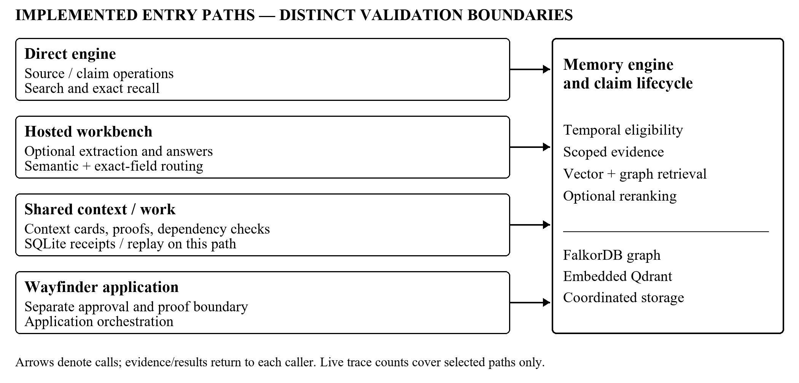

# Iron Web: Evidence-Grounded Temporal Memory for Reliable Long-Term LLM Agents

[Author names; affiliations; contact; funding: authors to complete]

## Abstract

Long-term memory for language model agents must handle information that changes after retrieval or after downstream work begins. This paper presents Iron Web, a temporal memory architecture that retains source evidence, represents claim lifecycles, and supports scoped retrieval and revalidation of context and dependent work. We study the implementation and reanalyze retained engineering records, separating source inspection, targeted regression assertions, live execution traces, and controlled experimental evidence. Four trace sets contain both successful and failed synthetic checks. The final hosted-workbench record contains eighteen passing checks across two models, whereas earlier records include extraction, correction, and citation failures. A partial eight-check record also conflicts with its accompanying eighteen-row summary, which we exclude. Source inspection establishes executing context-proof and dependent-work checks, but the retained hosted traces do not exercise that service path. Vector retrieval already performs lifecycle reconciliation, preventing its interpretation as an untreated dense baseline. No eligible controlled comparison establishes graph utility, general conversational accuracy, or an overall efficiency advantage. Observed component timings are descriptive samples without matched alternatives. The study contributes an implementation-grounded account of temporal evidence handling and its validation boundaries. It supports engineering behaviors while leaving comparative reliability, end-to-end revalidation effectiveness, and operational trade-offs open for controlled evaluation.

**Keywords:** agent memory, temporal evidence, context revalidation

## 1. Introduction

Retrieval-augmented generation supplies external information to a language model [1], and memory hierarchies extend access beyond the active context window [2]. Persistent agent memory additionally accumulates assertions that may later be corrected, superseded, retracted, or disputed. Semantic relevance does not establish that a retrieved statement is currently applicable. A previously assembled prompt or recorded task can also become stale after its supporting evidence changes.

Iron Web addresses this problem through explicit source and claim records, temporal eligibility, scoped retrieval, and guarded context/work use. We examine the implementation and retained records [3]. The contribution is an account of how these mechanisms interact and which behaviors the available evidence supports. It is not a new graph-search algorithm or a demonstrated improvement over existing systems.

The study asks four questions. RQ1 concerns handling corrected, superseded, retracted, and conflicting evidence. RQ2 concerns stale-context detection and dependent-work revalidation. RQ3 asks whether hybrid retrieval and graph expansion provide measurable utility. RQ4 concerns their ingestion, retrieval, revalidation, and storage costs. The evidence partially addresses implementation and selected behaviors; it does not establish general superiority or resolve every question.

## 2. Related Work

Mem0 extracts and updates compact memories; its graph variant adds relational representations [4]. Zep combines retained episodes, temporal facts, and hybrid retrieval [5]. Zep therefore provides prior art for preserving original evidence alongside derived relationships. Its paper describes provenance traversal but notes that the reported experiments do not directly examine those links. These precedents narrow Iron Web's contribution to the behavior and evaluation of its particular integration.

The MemPalace analysis motivates a strong raw-text retrieval baseline and warns against attributing retrieval gains to organizational metaphors [6]. Its retrieval-recall percentages cannot substitute for answer accuracy. Hindsight likewise distinguishes evidence, experience, and belief in its memory design [7]. Neither conceptual overlap nor an omitted evaluation establishes that a competing implementation lacks a feature.

Event validity and system-recorded time are established temporal-database concerns [8]. Provenance models distinguish entities, activities, and responsible agents [9]. Conditional validation is also established: HTTP preconditions can reject an operation when a representation has changed [10]. These are conceptual precedents, not claims that Iron Web implements either standard. LoCoMo [11] and LongMemEval [12] evaluate conversational memory, but do not replace a direct experiment on stale context and dependent work.

## 3. Problem Formulation

A source records text, origin, actor, confirmation state, recording time, and evidence group. A claim associates a subject, predicate, value, scope, validity interval, and supporting sources. Assertion introduces a candidate; confirmation changes its acceptance state. Correction identifies an earlier assertion as mistaken. Supersession represents a subsequent change. Retraction removes eligibility without requiring an invented replacement. Competing eligible values may remain disputed.

Exact recall distinguishes event time from a system-known cut-off. Its temporal predicate checks the validity interval, acceptance time, recording time, and whether an ending was known at the requested cut-off. Eligibility is not proof of truth. A historical assertion corrected later must not automatically be reported as a historical fact. Scope constrains the subject/task context in which evidence is usable.

A context proof identifies an assembled evidence state and its validity conditions. Work records identify supporting claims and prerequisite work. The reliability problem is to return an appropriate state and evidence, and to detect invalidated dependencies before accepting a response or completing recorded work. This definition is limited to represented requirements; it does not cover arbitrary unrecorded dependencies or external action atomicity.

## 4. Iron Web Architecture

Figure 1 separates four implemented entry paths. Direct calls reach the memory engine. The optional hosted workbench adds extraction, field routing, and answer generation. The shared context/work service adds receipts, context proofs, and dependency checks. Wayfinder uses a separate approval/proof boundary. Results from one path cannot establish the effectiveness of the others.

The engine coordinates a FalkorDB graph with embedded Qdrant vectors. Retrieval gathers vector candidates and bounded graph neighbors, reconciles temporal/lifecycle state, optionally reranks, and scores evidence. Source groups prevent repeated agent assertions from automatically counting as independent support. Ranking combines semantic, graph, recency, importance, entity, historical, contradiction, and reliability signals. The fuzzy reliability score is a heuristic, not a calibrated probability of truth.

Figure 1. Implemented call paths and shared memory core. The SQLite journal belongs to the shared-service path. This implementation map does not imply that every path was exercised in the retained live runs.

The shared runtime assembles essential fields and context cards within declared tokenizer budgets. Context stamps cover relevant source/claim data, scoped events, runtime identity, and process identity. Validation checks the stamp and expiry; the shared client can rebuild a response when evidence changes during generation. Claim updates can mark direct and transitive dependent work stale, while completion rechecks current requirements and ownership. These checks exist in code, but broad end-to-end effectiveness is not established by the retained live runs.

SQLite supports shared-service receipts and replay. Cross-store operations use coordinated graph publication, vector snapshots, and compensation rather than one transaction spanning all stores. Cold backup/restore requires declared ownership and fresh targets. Recovery tests and historical repair metadata therefore support narrower claims than universal crash safety or complete deletion across caches, journals, and backups.

## 5. Implementation

The inspected default selects CPU execution, extraction policy none, BAAI/bge-small-en-v1.5 embeddings with 384 dimensions, up to 100 vector candidates, two graph hops, and a 50-node graph bound. BAAI/bge-reranker-base is configured but disabled. Shared-service defaults are constructed separately; environment overrides can change effective settings. These are inspected defaults, not resolved manifests for every historical run.

The previously used environment contains FastEmbed 0.8.0, Qdrant client 1.18.0, FalkorDB client 1.7.1, and OpenAI client 1.60.0. CPU and GPU ONNX Runtime distributions coexist; installed packages do not prove active provider selection. The RTX 4050 Laptop GPU with 6 GB VRAM is user-reported, not independently verified by this study. No GPU inference result is inferred from an execution option.

With default extraction disabled, raw text need not yield structured facts. The hosted path instead validates model-derived claims, source quotes, scope, and citation identifiers. Quote membership does not prove entailment. Its exact-field routing may supply different answer evidence from the displayed semantic ranking. The context contract still requires travel-oriented scope/task fields; a general conversational benchmark adapter remains unfinished.

## 6. Evaluation Methodology

We reanalyze retained files and inspect code/tests without rerunning the application or calling an inference provider. Implementation evidence, historical engineering checks, controlled experiments, external results, and future hypotheses remain separate. Eligibility requires identifiable inputs, conditions, scoring, and interpretable supporting artifacts. Unfavorable observations follow the same inclusion rule as favorable ones. No controlled public-benchmark comparison meets these requirements in the accessible collection.

The four engineering trace sets use selected synthetic prompts, not public datasets or a frozen held-out split. Table 1 identifies their recorded outcomes. The first mixes raw episodes, supplied claims, and a hosted Llama 3.2 extraction/answer path. Later sets use Nemotron Lightning and Ultra as both extractor and answerer. Requests record top-k 5 and fresh session identifiers. Real cached BGE embeddings are reported; full historical provider/configuration manifests, seeds, reader token budgets, and repeat policies are unavailable. There is no matched alternative architecture or independent answer judge.

For Nemotron checks, Pass means every stored check predicate is satisfied; JSON/CSV case identities and grades are reconciled. A count of such checks is not conversational accuracy. Component medians use recorded inference_ms and adapter total_ms fields. One replayed zero-time extraction trace per model is excluded from inference timing; bounded repair attempts remain included. HTTP duration is a different boundary. Missing token usage prevents retrospective cost calculation.

Regression source is inspected for precise assertions, not treated as a new execution. Default fixtures substitute deterministic embedding/ranking functions, and selected token-budget tests use a toy tokenizer. Aggregate historical pass counts establish neither neural relevance nor the success of every current test. Missing execution logs limit independent reproduction.

Proposed evaluations will separate exact current/historical state correctness from evidence hit rate, all-evidence coverage, answer correctness, and stale acceptance. Each rate needs a predefined eligible denominator; timeouts remain visible. Lifecycle comparisons require identical claim inputs and a credible simple event-log resolver. Retrieval comparisons require matched candidates, reader context, routing, and models. Revalidation needs both stale interventions and valid controls. Public LoCoMo/LongMemEval evaluation must freeze extraction and dataset revisions; uncertainty should account for shared histories. These evaluations have not run.

## 7. Results

### 7.1 Temporal Evidence Reliability

Retained records show selected storage, correction, conflict, and supersession successes, alongside material extraction and citation failures. Table 1 preserves the progression without interpreting repaired repeated scenarios as generalization. The partial R3 JSON contains eight checks; its accompanying eighteen-row CSV is identical to R2's CSV and is excluded as an attribution of R3. These observations partially inform RQ1 but provide no controlled reliability effect size.

Table 1. Retained synthetic engineering checks, using reconciled JSON records [3]. Counts are checks, not answer accuracy or independent trials. Run identifiers appear in Appendix A.

| Run | Pass | Fail | Unsupported | Disposition |
|---|---|---|---|---|
| R1 | 11 | 10 | 3 | Mixed direct/hosted checks |
| R2 | 13 | 5 | 0 | Repeated development scenarios |
| R3 | 2 | 6 | 0 | Partial JSON; copied CSV excluded |
| R4 | 18 | 0 | 0 | Repeated final scenarios |

### 7.2 Revalidation and Retrieval Utility

For RQ2, executing invalidation/completion paths and targeted regression assertions exist, including a callback interrupted by a memory change. Accessible named execution logs are incomplete, and the retained hosted runs bypass the shared context/work service. End-to-end stale acceptance is therefore Not measured. For RQ3, no matched ablation establishes graph utility. Vector mode already reconciles lifecycle evidence; no-temporal and no-graph modes retain other temporal or graph-dependent processing. Default candidate pools also differ.

### 7.3 Observed Costs

For RQ4, Table 2 reports descriptive component timings from run R4's hosted path. There are thirteen non-replay extraction traces and seven generation/query traces per model. No matched architecture baseline, stable tail-latency estimate, ingestion/storage scale curve, or complete token/cost accounting is available. Component medians are not additive. The measurements answer a narrow observation question, not whether Iron Web is operationally preferable.

Table 2. Medians of recorded R4 hosted-path timings [3]. One replayed extraction trace per model is excluded; recorded repair attempts remain included. These samples have no matched architecture baseline.

| Model | Extraction (ms), n=13 | Generation (ms), n=7 | Adapter query (ms), n=7 |
|---|---|---|---|
| Lightning | 1709.398 | 907.842 | 2129.818 |
| Ultra | 4776.200 | 6543.537 | 9600.997 |

Model identifiers: nvidia/nemotron-3.5-lightning-30b-a3b; nvidia/nemotron-3-ultra-550b-a55b

## 8. Discussion

Explicit lifecycles make a distinction that similarity ranking alone cannot express: a relevant source can remain historically traceable while being ineligible for current use. The implementation operationalizes that distinction. The retained successes support its feasibility on selected examples, while earlier failures show that extraction and field consistency can prevent downstream correctness. Multiple repairs and repeated scenarios confound causal interpretations of the final passing record.

Revalidation is implemented beyond a dependency field: updates traverse claim users and dependent work, and completion reevaluates readiness. Nevertheless, source inspection is weaker evidence than a held-out intervention study. Always rejecting work could trivially reduce stale acceptance; valid-completion and false-block rates are also necessary. A generation-time proof check does not make external side effects transactional.

The evidence does not justify retaining graph expansion or fuzzy scoring on performance grounds. A simple event-log policy could achieve similar state correctness with lower cost. Conversely, bounded relational retrieval may help particular queries, but that is a hypothesis. Accurate condition labels and matched budgets are prerequisites to deciding whether to retain, simplify, or redesign these components.

## 9. Limitations and Threats to Validity

The live scenarios are small, synthetic, selected during engineering, and reused after repair. Checks sharing prompts, sources, or upstream failures are dependent. There is no independent annotation study, randomized controlled comparison, confidence interval, or demonstrated statistical significance. Hosted model identity, extraction quality, field routing, provider behavior, and network conditions can affect both answers and timings. Structured-claim behavior must not be generalized to unrestricted natural-language ingestion.

Historical source backups are partial, resolved manifests are missing, and some referenced XML/JSON execution artifacts are unavailable. One audit subtree was inaccessible. Thus current content hashes identify the inspected snapshot but do not recreate every historical runtime. No complete public benchmark or independently comparable head-to-head result exists. The current context adapter is domain-specific, and historical database repair records limit broad persistence claims.

Represented source authority depends on trusted callers; evidence groups do not independently prove source independence. Citation-ID checks do not establish entailment, and fuzzy scores are uncalibrated. Revalidation may add latency, false blocking, or bypass risks that remain unquantified. The study establishes neither universal contradiction detection, perfect historical recall, complete deletion, cross-store atomicity, adversarial isolation, nor lower token cost.

## 10. Conclusion and Future Work

Iron Web implements temporal claim handling and source-linked memory with distinct retrieval, hosted, context/work, and application boundaries. Reanalysis supports selected engineering behaviors and preserves failed and inconsistent records. It does not establish comparative accuracy, graph utility, or overall efficiency. Context/work guards are implemented but lack retained end-to-end validation on the hosted trace sets.

The highest-priority evidence is a controlled lifecycle comparison against a simple event-log policy, followed by stale-context/work interventions with valid controls and matched retrieval/cost ablations. Frozen conversational evaluation should follow, not substitute for those mechanism tests. Null or negative results should justify narrower claims or a simpler design rather than be discarded.

## Appendix A Reproducibility

The audited base commit is dc96f3550767e30059293cdc639d900331ab385a. Pre-existing working-tree changes make that commit insufficient on its own. The accompanying artifact_hashes.csv identifies 202 source/configuration/evidence files; source_index.json records symbol locations. audit_manifest.json documents access limits, while retained_run_summary.json records reconciled checks, exclusions, timing sample counts, and medians [3]. No new benchmark, application test, inference call, or database operation was executed for this manuscript.

R1–R4 map respectively to live_1023_121339, nm_1023_124524, nm_1023_125245, and nm_1023_125909. The retained records date to 23 October 2026 in their reports. Current validation scripts record the workbench protocol, but should not be rerun against existing memory stores merely to reproduce this paper. Offline aggregation can be regenerated with build_audit_manifest.py from the repository root using the recorded dependency environment. This reproduces artifact summaries, not the historical provider outputs. A sanitized public artifact release and author metadata remain author responsibilities.

## References

[1] P. Lewis et al., “Retrieval-augmented generation for knowledge-intensive NLP tasks,” arXiv:2005.11401v4, 2021. https://arxiv.org/abs/2005.11401v4

[2] C. Packer et al., “MemGPT: Towards LLMs as operating systems,” arXiv:2310.08560v2, 2024. https://arxiv.org/abs/2310.08560v2

[3] “Iron Web implementation and evidence audit,” unpublished project technical report and supporting artifact manifests, Oct. 24, 2026. Historical engineering records are not independently reproduced.

[4] P. Chhikara, D. Khant, S. Aryan, T. Singh, and D. Yadav, “Mem0: Building production-ready AI agents with scalable long-term memory,” arXiv:2504.19413v1, 2025. https://arxiv.org/abs/2504.19413v1

[5] P. Rasmussen, P. Paliychuk, T. Beauvais, J. Ryan, and D. Chalef, “Zep: A temporal knowledge graph architecture for agent memory,” arXiv:2501.13956v1, 2025. https://arxiv.org/abs/2501.13956v1

[6] R. Dey and P. Viradecha, “Spatial metaphors for LLM memory: A critical analysis of the MemPalace architecture,” arXiv:2604.21284v1, 2026. https://arxiv.org/abs/2604.21284v1

[7] C. Latimer et al., “Hindsight is 20/20: Building agent memory that retains, recalls, and reflects,” arXiv:2512.12818v1, 2025. https://arxiv.org/abs/2512.12818v1

[8] R. Snodgrass and I. Ahn, “Temporal databases,” Computer, vol. 19, no. 9, pp. 35–42, 1986, doi: 10.1109/MC.1986.1663327. https://doi.org/10.1109/MC.1986.1663327

[9] L. Moreau and P. Missier, Eds., “PROV-DM: The PROV data model,” W3C Recommendation, Apr. 30, 2013. https://www.w3.org/TR/2013/REC-prov-dm-20130430/

[10] R. Fielding, M. Nottingham, and J. Reschke, Eds., “HTTP semantics,” RFC 9110, June 2022, doi: 10.17487/RFC9110. https://www.rfc-editor.org/rfc/rfc9110.html

[11] A. Maharana et al., “Evaluating very long-term conversational memory of LLM agents,” Proc. ACL, vol. 1, pp. 13851–13870, 2024, doi: 10.18653/v1/2024.acl-long.747. https://aclanthology.org/2024.acl-long.747/

[12] D. Wu et al., “LongMemEval: Benchmarking chat assistants on long-term interactive memory,” arXiv:2410.10813v2, 2025. https://arxiv.org/abs/2410.10813v2
