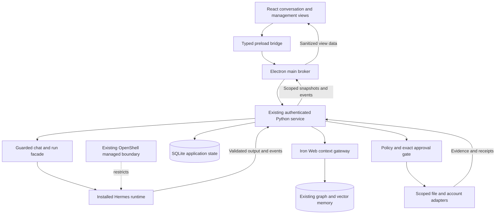
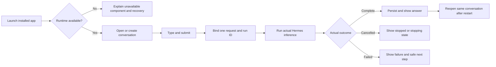
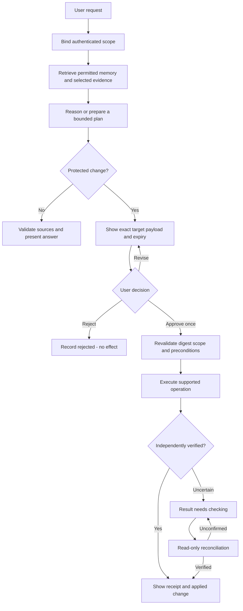
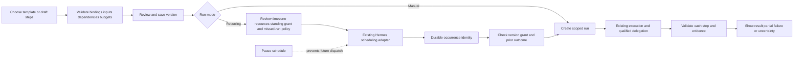
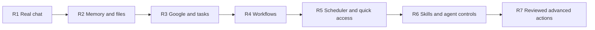

# Draft flows

Planning diagrams. All new desktop releases, adapters and interfaces shown here are proposals, not current release evidence. [Return to the plan](PLAN.md).

## Presentation architecture

The renderer never receives database access, a bearer token, a generic shell API or a generic authenticated HTTP proxy. Keep existing Origin rejection. An SDK-based Hermes Desktop host must demonstrate equivalent control before adoption.

## R1: first user conversation

If cancellation cannot yet stop the upstream inference, show that distinction and suppress publication of a supposedly active answer. A renderer reconnect observes the same run rather than resubmitting it.

## R2 onward: evidence and exact change review

Revising produces a fresh proposal/digest and invalidates the old approval. Reconciliation does not silently retry a write. Model output cannot take the approval branch.

## R4/R5: workflow and recurring occurrence

Pausing future occurrences does not undo a dispatched effect. An edited template does not inherit the old scheduled authorization. Sleeping/offline behaviour is defined per schedule; UI timers do not own recurring execution.

## Release evolution

Every arrow means: add complete functionality, refine observed friction, migrate data safely and rerun earlier acceptance cases.
