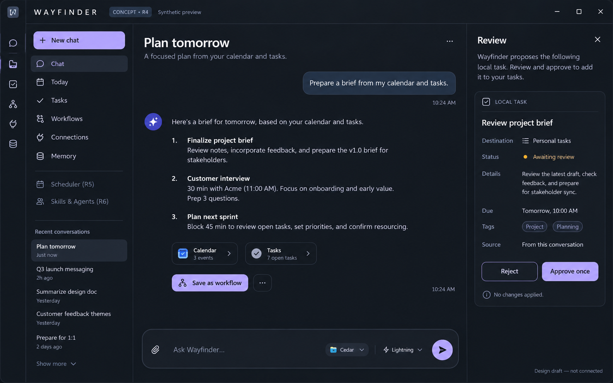

# Wayfinder desktop: a small first release that grows into the full product

Design proposal · 26 October 2026 · Windows first · planning artifacts only

**Product decision:** deliver a real desktop application with a conversation-led workspace. Use **Electron + React + TypeScript**, backed by existing Wayfinder services and Hermes. Each release must be useful on its own, preserve previous workflows, and add a small set of complete capabilities. “Minimal” describes the first feature set, not the quality of the interaction.

This proposal replaces the *future UI delivery sequence* in MVP v2 with cumulative desktop releases. It does not replace its memory/permission requirements, rewrite the existing backend, mark any acceptance case passed, or authorize implementation. Existing Tkinter code and pending work stay intact until the replacement is accepted. No account login, package installation, runtime change, desktop automation or app launch was performed for this design.

## Read the design

- [Clickable, offline design preview](preview.html) — synthetic interface states, not a working assistant.
- [Main workspace wireframe](assets/workspace.svg).
- [Release ladder](assets/releases.svg).
- [Architecture and interaction flowcharts](FLOWS.md).
- [Worker-to-product mapping](WORKER-SURFACES.md).
- [Manual release acceptance checklist](ACCEPTANCE.csv) — every case begins Not run.
- [Research and architectural decisions](RESEARCH.md).

This image illustrates the visual direction, not the final approval contract. The implemented review must show exact targets, absolute dates/timezones where applicable, payload, scope and expiry. The screenshot's fictional task and conversation do not represent a run or a connected account.

## 1. What to borrow from the reference

The supplied screenshot is a UX reference, not a specification of existing Wayfinder features. Borrow these behaviours:

1. A stable navigation rail and a context sidebar; conversations and tasks remain easy to return to.
2. A readable central conversation and a composer that stays available.
3. An optional right panel for sources, task plans, drafts, approvals and run details. Chat does not become a scrolling wall of infrastructure logs.
4. Clear current context: conversation, memory space and selected model. Model names do not imply broader permissions.
5. Progressive disclosure: a simple question looks simple; a multi-step task reveals its plan when needed.
6. Keyboard shortcuts, predictable back navigation, resizable panels and continuity after restart.
7. Exact change review beside the conversation, with clear pending/applied/uncertain states.

From Hermes, retain reasoning, session/execution adapters, skills, capability metadata, delegation and scheduling where compatible. The new application is their approachable front end. Do not copy Codex branding, pretend to know its private implementation, or expose every backend setting as a user-facing control.

## 2. Recommended stack and the reuse decision

| Layer | Choice | Reason |
|---|---|---|
| Desktop host | Electron, current maintained stable release pinned at implementation | Established desktop ecosystem and the same host used by current upstream Hermes Desktop. |
| UI | React + TypeScript | Reusable conversation, sidebar, form and inspector components; compatible with Hermes's current frontend stack. |
| Build tooling | Vite, with electron-vite for a standalone shell | Separate main/preload/renderer builds. Reuse upstream build tooling if extending a qualified Hermes Desktop instead. Choose one packaging path. |
| Design system | Tailwind CSS + accessible Radix/shadcn-style components + Lucide icons | Consistent spacing, forms, dialogs, tabs and keyboard interaction without hand-building every widget. If using Hermes Desktop, use its SDK UI kit instead of adding a competing component library. |
| Chat rendering | Evaluate the assistant-ui components already used upstream; sanitized Markdown/code rendering | Reuse selection, scroll anchoring and message/composer primitives. Never make its sample backend the application's source of authority. |
| UI data | TanStack Query for server snapshots; React state for local view state | Runs, approvals and tasks remain backend-owned. UI state stores only presentation choices. |
| Backend | Existing Python AppService, platform services and workers | Preserve Iron Web, authorization, current contracts, SQLite state and tested execution boundaries. No parallel Node memory/workflow backend. |
| Reasoning | Existing managed Hermes/OpenShell installation | New guarded chat binding using the installed runtime; no replacement agent loop. |
| Desktop-to-backend | Narrow typed preload IPC → Electron main broker → authenticated loopback Python API | Renderer receives no bearer token or generic command/URL execution capability. |
| Persistence | Existing SQLite application records + Iron Web's FalkorDB/Qdrant | Conversation/run state and durable facts retain separate lifecycles. |
| Packaging | electron-builder; local unpacked/portable Windows build first, installer later | A launchable app from R1. Code signing and upgrade/rollback qualify before distribution beyond the development machine. |
| Verification | Existing pytest + Vitest/React Testing Library + Playwright | Component and integration checks plus real Windows walkthroughs. Playwright's Electron integration is currently experimental; retain manual packaged-app checks. |

Electron is a mainstream choice, not a provable universal “most-used AI assistant stack.” Its official showcase includes VS Code, Slack and Discord. Current Hermes source independently confirms Electron, React, TypeScript, Vite and Tailwind. These are stronger reasons than choosing a framework solely by popularity. Sources and limits are in [RESEARCH.md](RESEARCH.md).

**Tauri alternative:** attractive when distribution size and system-WebView use dominate. It adds a Rust/core integration surface and is not the stack currently used by upstream Hermes Desktop. Keep it as a later reconsideration if measured Electron resource use fails the agreed target; do not build two desktop hosts.

### Hermes-first compatibility spike, before R1 implementation

Current upstream Hermes Desktop has extension points for panes, routes, sidebar items, themes and commands. First assess whether the installed/pinned deployment can host the Wayfinder experience through these APIs. Reading current upstream documentation does not establish compatibility with installed Hermes 0.21.3.

Use an extension-based delivery **only if all of these pass**: existing Wayfinder authorization remains authoritative; every exposed action follows its gate; no default terminal/file/memory route bypasses it; task/space binding is preserved; the required conversation and right-panel UX can be delivered; packaging works with the existing WSL/OpenShell topology; licenses permit reuse.

If these checks fail, use the recommended **thin Wayfinder Electron shell** with a typed bridge to the existing backend. Reuse suitable licensed UI primitives and Hermes protocols; do not fork the whole Hermes product merely to recolour it. This fallback changes the presentation host, not the reasoning runtime, memory system or scheduler. The implementation decision record must say which check determined the result.

## 3. Stable layout, progressively revealed features

At a wide window: **navigation rail → conversations/list → main workspace → optional inspector**. Default to one main content pane. A second chat pane is optional later; do not reproduce the screenshot's split view on every screen.

Suggested dimensions: 56–64 px rail, 220–260 px list, 680–820 px readable chat region, 320–420 px inspector. These are draft targets. At narrower widths, collapse the inspector into a sheet and then the list into a drawer; never shrink review text until it becomes unreadable. Validate at 1280×800, 1920×1080, keyboard-only, and Windows 100/125/150% scaling.

| Final product destination | What a user does there | First release |
|---|---|---|
| Chat | Talk, attach evidence, follow work and review outcomes | R1 |
| Runs / Reviews | Reopen task progress, approvals, receipts and recovery | Basic R1; richer R2/R4 |
| Memory | Inspect remembered facts, sources, conflicts and history | R2 |
| Today / Tasks | See a useful daily view and manage reviewed work items | R3 |
| Connections | Connect/test/revoke scoped Google and other integrations | R3 |
| Workflows | Save and run repeatable, editable step lists | R4 |
| Scheduler | See next/last runs and pause approved recurring work | R5 |
| Skills | Inspect and invoke reviewed reusable procedures | R6 |
| Agents | Inspect logical worker roles, bindings and allowed capabilities | R6 |
| Projects | Inspect permitted repositories, drafts and diffs | R7 |
| Settings | Models, appearance, privacy, resources and runtime health | R1, expanded over time |

Do not ship nine empty tabs in R1. Enable destinations as they become useful. Put future capabilities in a small roadmap/help view, rather than an enticing enabled button that cannot work. Role IDs remain available in advanced details; ordinary users see names such as “Document analysis.”

## 4. Cumulative releases

There is one evolving application, one data model and one navigation system. Every release retains and regression-tests the previous release's functionality. “Polish” is work in every release, rather than a final phase.

### R1 — A real conversational app

**You can:** launch Wayfinder from a Windows shortcut; create/reopen a conversation; ask the actual Hermes-backed model a question; stop a run; restart and find the conversation again. Settings exposes the selected model and honest runtime availability. No code editor or terminal is required for routine use after setup.

**Build:** Electron shell, shared typography/components, chat list, Markdown/code rendering, composer, real run states and basic settings. Add an authenticated conversation/run facade to existing Python services and a guarded general-chat Hermes binding. The current `transcript` endpoint only stores messages; it does not generate replies. Existing W35 analysis is not a general-chat API. R1 fails if the assistant is an echo, canned demo or transcript-only replacement.

Prefer real token streaming from verified Hermes callbacks. If installed compatibility only supports a final response, R1 may show “Generating response” and then the actual completed answer; disclose this limit and do not imitate streaming by replaying text. R2 must qualify native deltas if offered. Persist user messages, completed assistant messages and terminal outcomes; interrupted partial text is visibly incomplete.

**User walkthrough:** open → ask “Explain this project in three sentences” → receive a real reply → stop a second request → reopen the first conversation → quit/relaunch. Then stop the backend and verify the app explains how to recover instead of hanging.

**Retained-feature refinement:** focus management, Enter/Shift+Enter, copy, scroll position, readable code, accessible contrast, narrow-window behaviour. Do not require full provider/plugin/scheduler setup for basic chat.

### R2 — Chat with trustworthy memory and documents

**You can:** explicitly remember a preference, inspect what was retained, correct/retract it, and use it in a fresh conversation. Select a local document and ask a grounded question with source references. The right inspector shows evidence and a simple step timeline.

**Reuse:** scoped Iron Web gateway, current claim lifecycle, previews/exact approvals, W34 file discovery and W35 document analysis. Expose an explicit “Remember” action first; automatic intent interpretation can propose a change but cannot silently store it. Arbitrary prose-to-structured fact mapping is a real integration task, not an already-working feature.

**User walkthrough:** in a synthetic space, remember “Project Cedar keeps records for 30 days”; approve; open a new chat and ask; compare a selected file saying 42 days; see the discrepancy; reject a correction once, then approve a fresh correction. A second space must remain separate.

**Retained-feature refinement:** real stream events where supported, source-opening, attachment chips, cancellation feedback and message retry semantics. A chat retry creates an explicit new read attempt; it cannot resend an external effect.

### R3 — A useful day view with Google

**You can:** connect Google Calendar, Google Tasks and Gmail; see upcoming events and tasks; request a daily brief; inspect source links; disconnect an account. Start with qualified reads. Gmail message-body/metadata retrieval and reply drafting need additional qualified operations; the current adapter returns message references only.

Add a persistent local task list through an explicit `WorkItem` service, with optional Google Tasks binding. A task, an agent run and a schedule are distinct records. Do not repurpose workflow status rows as todo items. Start Google task/event writes only after exact-operation approvals and provider receipts pass; message sending remains unavailable at this release.

**User walkthrough:** connect a test account → compare the app's next events/tasks with Google → ask for a brief → create one local task → propose one supported Google task change → reject once → approve a fresh proposal and verify it in Google. If write qualification is blocked, ship a clearly read-only R3a and do not mark the write case passed.

**Retained-feature refinement:** remembered display preferences, clear date/timezone language, keyboard navigation and granular connection errors. Account connection is not blanket authorization for actions. Fitness remains deferred by the user's explicit choice.

### R4 — Repeatable workflows

**You can:** turn a successful daily brief into a saved workflow, edit its steps, validate it, run it manually, watch progress, cancel and reopen results. Begin with a **step list**, inputs and a dependency preview. A drag-and-drop graph is a later enhancement if user testing warrants it.

**Build/qualify:** versioned template and run interfaces; exact capability bindings; cycle/missing-input checks; task scopes; budgets; persisted steps; validated data passing; explicit partial failure. Reuse Hermes delegation where its effective toolsets and routing are demonstrated. The present controller is one fixed read recipe; arbitrary multi-step workflows are not already implemented.

**User walkthrough:** create “Daily brief” with Calendar read → Tasks read → Brief synthesis; run twice and receive two distinct run records; cancel an active read run; restart and inspect an interrupted attempt without replaying a completed write. A broken connection must name the blocked step and retain successful evidence appropriately.

**Retained-feature refinement:** quiet progress in chat, detail on demand, editable draft plans, preserved conversation position and direct links from a brief to its source run.

### R5 — Scheduler and quick access

**You can:** schedule an approved read-only brief in your timezone, see the exact next/last occurrence, pause it and resume future occurrences. A small quick-chat window shares the same conversation and approvals as the main app, with optional tray/hotkey behaviour.

**Reuse/qualify:** existing Hermes scheduling facility behind a trusted scheduling adapter. Store user-facing schedule/grant/occurrence mapping in the application, with one authority per occurrence. No second cron engine or ad-hoc `setInterval` scheduler. If Hermes cannot satisfy occurrence identity, scoping or missed-run behaviour, keep recurring execution unavailable until an explicit adapter/architecture decision resolves it.

**User walkthrough:** set a short test schedule → observe one occurrence → pause → observe no future occurrence → restart → see the documented missed-run result → open quick chat and continue the same conversation without duplicate execution.

**Retained-feature refinement:** notifications link to the actual run, the main/quick views stay consistent, and window close versus Quit is understandable. Sleeping/offline laptops are visible limitations; no claim of 24/7 execution. A schedule change requires review of the revised version and standing grant.

### R6 — Skills and agent configuration

**You can:** browse actual available worker roles and skills, see what each may access, test a bounded role against a synthetic fixture, publish an approved skill version and roll it back. Save a simple model/budget preset within allowed limits.

**Reuse:** Atlas metadata, installed Hermes profiles/skills and existing worker-owned configurations. UI state distinguishes **Planned**, **Configured**, **Tested**, **Unavailable** and **Disabled**; metadata alone never produces a green working badge. “Enable agent” enables a qualified binding, not a permanent process or a broad permission grant.

**User walkthrough:** inspect Document Analyst → view its allowed inputs/tools → run a fixture → review a skill change → reject it → approve a revised version → revert. Disabling a required binding causes a dependent workflow to explain why it cannot run.

**Retained-feature refinement:** command palette, searchable navigation, human-readable capability explanations and guided setup. Advanced raw configuration remains behind validated forms and reviewed diffs.

### R7 — Reviewed coding, communication and optional desktop actions

**You can:** inspect a granted repository, review an actual diff, and apply only a specifically qualified operation. Add reviewed Gmail drafts/sends and selected desktop actions as separate optional capabilities, each with its own provider/driver qualification.

The current qualified Git operation creates one local branch. Code edits, tests, commits, pushes, PRs and merges are separate operations, not implied by that qualification. Show exact recipients/content for communication. W37 stays unavailable until the user separately re-enables native testing and host execution independently passes. Approved screenshot input is a separate optional grant, never background monitoring.

**User walkthrough:** reject a proposed change and observe no effect; approve one supported fresh proposal; independently verify the receipt; inject a lost acknowledgement and reconcile without automatically repeating the effect. Restore an older application version against a supported backup without opening the live runtime concurrently.

**Retained-feature refinement:** installer/signing, update review, migration/rollback, performance, accessibility and long-session stability. Voice, mobile, cross-device sync and fitness vendors remain separate later product decisions.

## 5. State, trust and integration boundaries

Renderer is an untrusted presentation process: `contextIsolation: true`, `sandbox: true`, `nodeIntegration: false`, restrictive CSP and no arbitrary IPC/shell bridge. A native app cannot make a backend safe merely by hiding a button. Final Python handlers continue enforcing scope and exact approval.

The current Python API deliberately refuses browser `Origin`/fetch requests. Preserve that check. Electron main performs approved authenticated requests on the renderer's behalf; do not weaken CORS or place a bearer token in React/localStorage to make direct fetching work. Give preload one typed method per supported intent, validate sender/frame and payload in main, and validate again in Python.

Use one authoritative run/approval identity across all views. Run transitions and receipts are backend-owned. Main-process UI preferences must not become an alternate fact or workflow store. One backend process owns each embedded Qdrant/journal runtime; Electron must discover/attach to a compatible instance or start one owner, not open the live store twice.

Proposed additive interfaces, versioned before implementation: `chat_start`, `chat_events(after_sequence)`, `chat_cancel`, `workitems_*`, `workflow_templates_*`, `workflow_runs_*`, `schedule_*`, `capability_bindings_*`. Names are illustrative. Existing `platform_*`/worker contracts remain the compatibility baseline. Events include durable run ID, scoped conversation, sequence, type and bounded payload. A UI reconnect resumes observation, not execution. Actual usage/cost is shown only when the provider reports it.

On an uncertain external result, show **“Result needs checking”** with the affected operation and a read-only reconciliation action. Do not show an ordinary Retry button that could send an email or duplicate an event.

## 6. A release is accepted by use, not a screenshot

Every delivered release includes a Windows-launchable build; release notes; truthful setup/connection status; a short first-run walkthrough; exact start/stop/quit behaviour; user acceptance cases; redacted actual run evidence; a known-limits list; and a return path to the previous accepted release.

All prior acceptance cases remain regression cases. No required case may be Blocked while the release is labelled fully accepted. Explicit read-only subreleases are acceptable when their advertised scope is complete. Unavailable optional features are removed from the active navigation or visibly disabled.

Suggested UX targets, to confirm on the actual laptop: app chrome should remain responsive while inference is pending; submit/stop acknowledgement should feel immediate (target under 250 ms locally); opening a cached conversation should normally complete under 500 ms. Measure cold start, idle RAM and CPU before setting numeric budgets; do not confuse model/network latency with UI latency or promise an installer size without a build.

Test keyboard-only operation, screen-reader names, non-colour status labels, high-DPI layout, long transcripts, offline provider, missing WSL/Docker, lost connection, app restart, double-click submission, two windows observing one run and schema migration. Backend fixtures, live model tests, real provider tests and native driver tests remain distinct evidence tiers.

## 7. Implementation order for the first release

1. Resolve Hermes Desktop extension compatibility and choose a single delivery host. Preserve a recoverable baseline; change no active runtime configuration during this planning step.
2. Build the packaged shell and typed IPC broker around real backend health/space/conversation data. Prove the renderer cannot reach privileged generic operations.
3. Implement the genuine general-chat run binding through existing Hermes, with bounded execution, cancellation, persisted outcomes and honest provider errors.
4. Connect conversation rendering, composer and real lifecycle events. Add session continuity and accessible keyboard behaviour.
5. Package a laptop build, run R1's automated/manual checks, and let the user use it for ordinary conversation. Fix observed friction before adding Memory/Google/Workflows tabs.

There is no reliable calendar estimate until the compatibility/packaging spike is measured. Release boundaries are acceptance-based. The architecture is intended to survive the later releases; the first build stays deliberately small.
