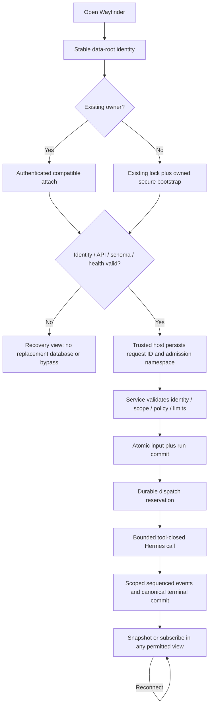
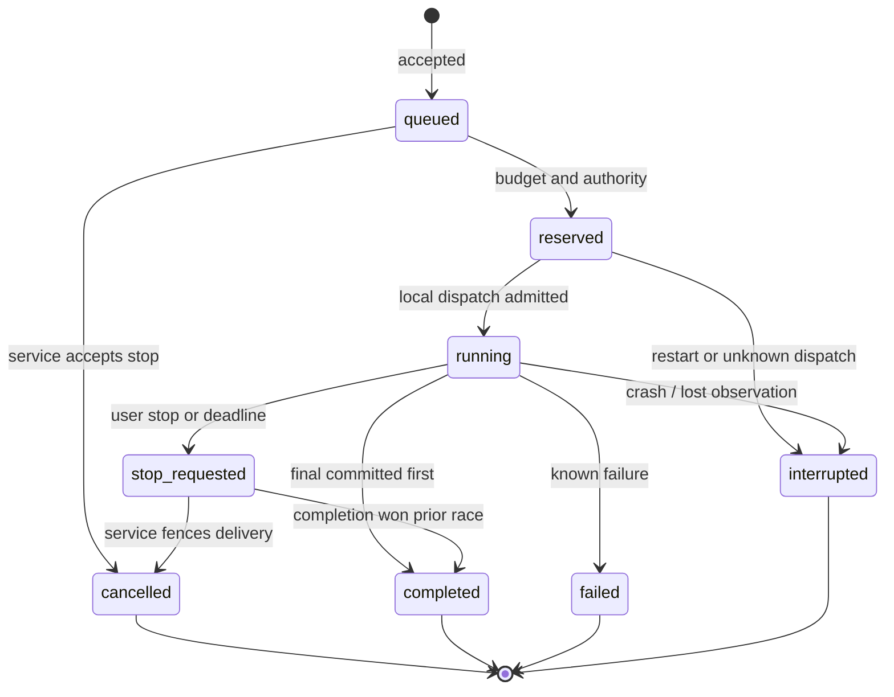
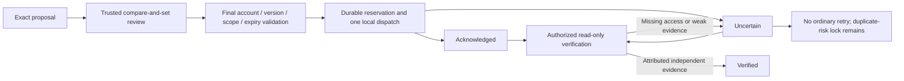
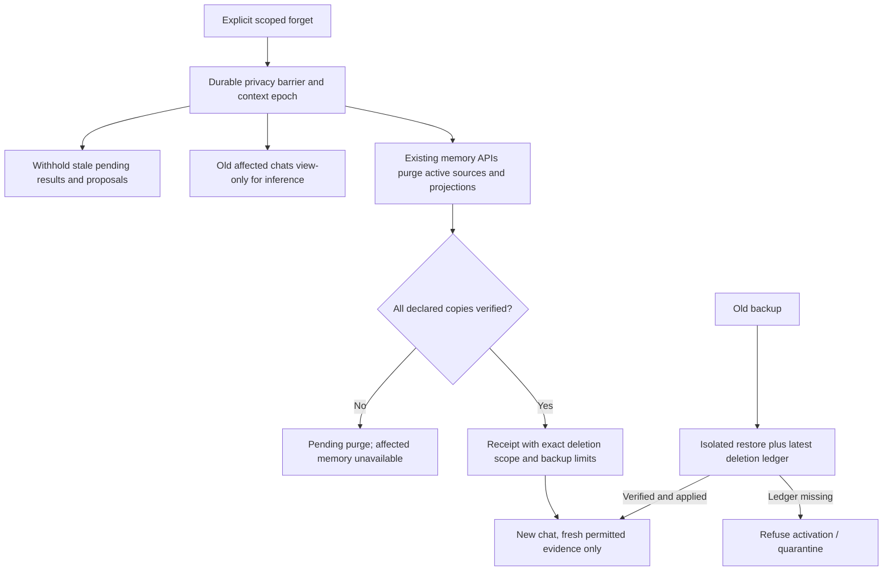
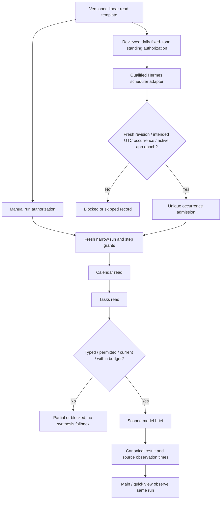

# Revised flows

All diagrams are proposed integration paths. A passed offline model does not qualify an installed adapter. Contract references resolve in [CONTRACTS.md](CONTRACTS.md).

## Runtime and request admission

## Cancellation and uncertainty are separate

Cancellation fences delivery/admission; it does not prove an upstream abort or absence of external effects. The latter has a distinct machine:

## Forget without derived-context resurrection

## Workflow and daily schedule

The adapter reuses the installed scheduler; this diagram does not introduce a second clock loop. Core workflows cannot contain writes. Same-day schedule edits default effective next local day; sleep/missed times skip without a burst.

## Cumulative delivery

```mermaid
flowchart LR
    G[Compatibility and contract spike] --> R1[1 Real chat]
    R1 --> R2[2 Memory and documents]
    R2 --> R3[3 Provider reads and local tasks]
    R3 --> R4[4 Linear read workflows]
    R4 --> R5[5 Daily schedule and quick access]
    R5 --> R6[6 Skills and roles]
    R6 --> R7[7 Repository review]
    R7 -. separate qualification .-> OPT[Optional exact effects / selected images / native]
```

Every arrow requires prior applicable acceptance plus shared-boundary regression. Deferred research/notes/fitness are not implied by any box.
