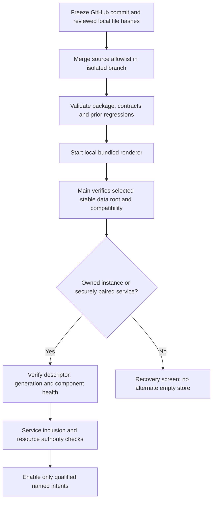
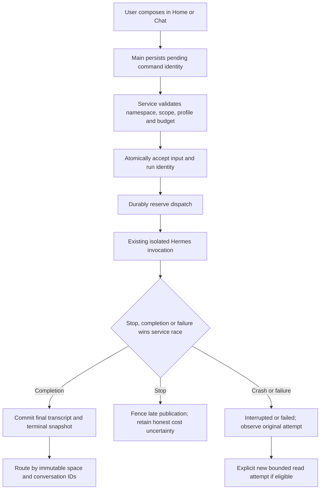
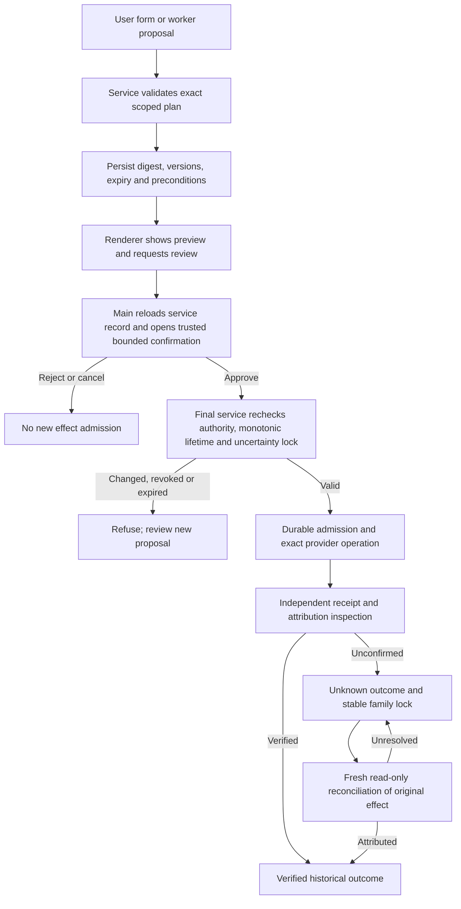
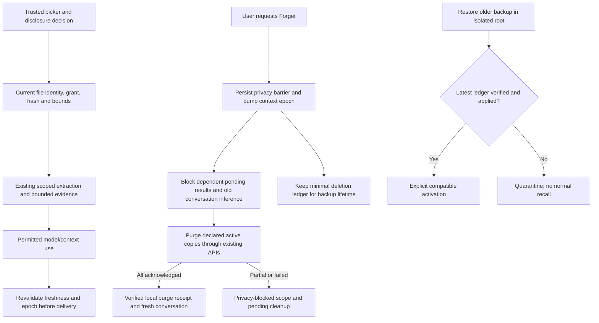
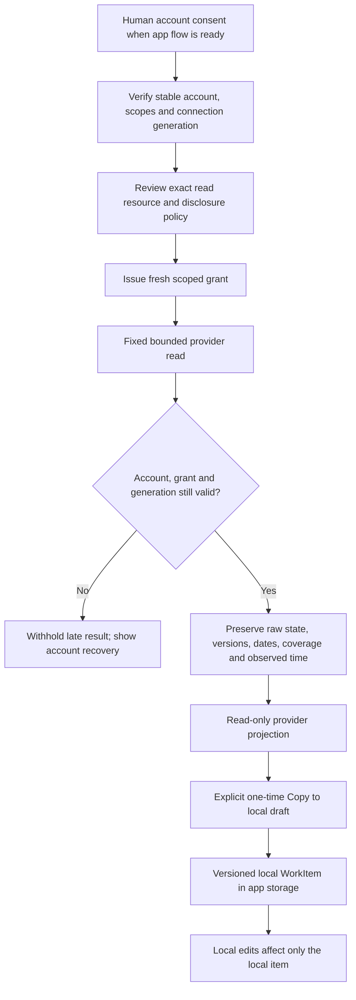
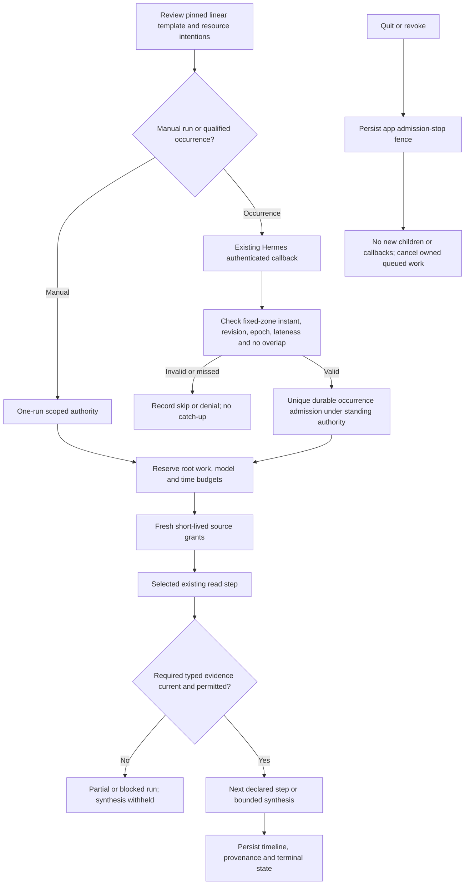

# Proposed interaction and authority flows

These are static planning diagrams. They do not run agents, authorize resources or assert implemented endpoints. See C01–C23 and U01–U12 for failure details.

## Source assembly and app ownership

The original checkout is never reset/copied live. A failed attach is not permission to steal a lock or trust a listening port. A source import does not migrate a runtime.

## Ordinary chat, not automatic memory

Remember is a separate reviewed operation. A connection retry observes the original request; it does not submit a new ID. No W35/echo/fixture fallback exists for ordinary chat.

## Exact memory or optional connector review

A new title, request ID, UI window or connection generation cannot bypass the family lock. The upstream in-memory token alone is never the final application approval.

## Selected evidence and forget barrier

Retraction, chat deletion and artifact clearing remain separate. Old history, provider disclosure and independent backups are not silently declared erased.

## Google reads and independent local tasks

An empty/partial/error response does not become a complete day. Copy is not sync, and consent is not an external-write approval.

## Linear workflow and standing daily read

The adapter does not create another cron executor. Main and quick chat share one runtime and request/draft authority; neither can extend a workflow budget.
