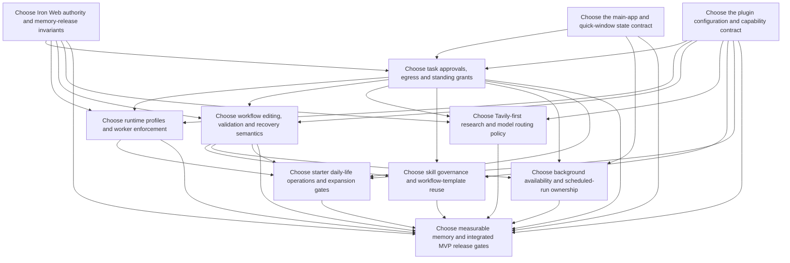

# Open decision frontier

## Available now

- [Choose the main-app and quick-window state contract](issues/01-app-quick-state.md)
- [Choose Iron Web authority and memory-release invariants](issues/02-memory-authority.md)
- [Choose the plugin configuration and capability contract](issues/03-plugins-capabilities.md)

## Waiting on prerequisites

- [Choose task approvals, egress and standing grants](issues/04-approval-egress.md)
- [Choose runtime profiles and worker enforcement](issues/05-runtime-workers.md)
- [Choose workflow editing, validation and recovery semantics](issues/06-workflow-contract.md)
- [Choose Tavily-first research and model routing policy](issues/07-tavily-model-routing.md)
- [Choose skill governance and workflow-template reuse](issues/08-skill-reuse.md)
- [Choose background availability and scheduled-run ownership](issues/09-background-lifecycle.md)
- [Choose starter daily-life operations and expansion gates](issues/10-starter-adapters.md)
- [Choose measurable memory and integrated MVP release gates](issues/11-release-evidence.md)

## Dependencies

Claim one available ticket before work. Human-facing references use ticket names; tracker numbers are only dependency mechanics. All design tickets remain open.
