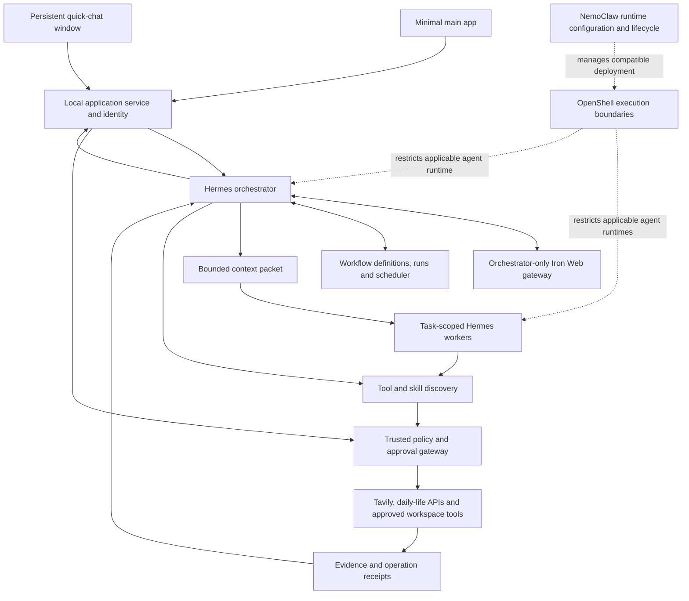

# WAYFINDER — New MVP master plan

Version 2 · 24 October 2026 · Windows / local first

**Product:** a configurable personal AI application with remembering chat, Tavily-backed web research, connected tools, editable workflows, reusable skills and controlled execution. A small persistent quick-chat window is a second view into the same application.

This is a new plan, not an implementation claim. It supersedes the animal-companion scope and earlier delivery sequence for the MVP. The old plans remain historical records. No models were called, plugins installed, accounts connected, jobs scheduled or runtime code changed while preparing this plan.

## 1. Scope and precedence

The latest user request governs this version. The [supplied master plan](sources/SUPPLIED-MASTER-PLAN.md) is background input; its animal and screen-capture sections are not active requirements. Earlier confirmed Windows/local storage, orchestrator-only memory access and narrowly approved recurring jobs remain in force.

### MVP requirements

1. A minimal main app for chat, plugin configuration, workflow creation/editing, memory inspection, reusable skills, approvals, runs and settings.
2. A movable/resizable quick-chat window the user can leave open, hide to tray or summon with a configurable hotkey. It uses the same backend, accounts, permissions and selected conversation/space as the main app.
3. Useful general conversation, online research, document understanding, bounded tool use and task execution, with clear progress and source references. “Like Codex or Claude Code” is a usability direction, not a claim of full feature/model parity.
4. Hermes-based execution and extensible daily-life connectors, with versioned atomic tool operations and compatible MCP/plugin adapters.
5. NemoClaw configuration for the chosen compatible agent environment; OpenShell restrictions plus application-level authorization. The app's workflow engine owns workflow definitions and run state.
6. Existing Iron Web as the sole declared durable knowledge authority for approved user facts/decisions; only the orchestrator receives memory-service access.
7. Reusable skills with discoverability, visible versions, approval of changes and rollback.
8. Strong data control: scoped access, consent-aware retention, exact action previews, export/forget, visible egress and honest failure/recovery behavior.
9. A manual test and acceptance checkpoint after every build phase.

### Explicitly excluded from this MVP

Animal characters/animation, desktop scanning, screen capture/recording, always-on microphone, unrestricted computer control, unreviewed plugin/skill installation, silent external writes, online multi-user operation and cross-device sync. Voice and broader browser automation can be separate later increments.

“24/7 window” means available while the app/service and Windows device are running. Sleep, power loss and offline providers are visible states, not an availability guarantee. Background startup is a user-controlled setting; closing a window and stopping the background runtime are distinct actions.

## 2. What the user gets

| App area | Minimum useful behavior |
|---|---|
| Chat | New/resumed conversations; streaming where supported; stop/retry; source references; attachments/selected files; active memory space; model/provider indicator; task-plan preview |
| Plugins / Connections | Reviewed catalog; configure credentials securely; connect/test/enable/disable/disconnect; inspect operations, account scope, health and last sync; review updates and permission changes |
| Workflows | Create from natural language or a simple step/dependency form; inspect/edit a draft; validate; save a version; run; pause/cancel; inspect results; reuse as a template; configure an approved schedule |
| Memory | Spaces, searchable records, provenance, current/history/conflict states, remember/correct/forget proposals, retention controls, export and deletion status |
| Skills | Browse approved procedures; view required capabilities/version; invoke with inputs; inspect proposed changes; approve/reject; roll back |
| Runs / Approvals | Step states, selected tools, evidence, limits, receipts, pending exact changes, approve/edit/reject, blocked/failed/uncertain outcomes and recovery controls |
| Settings | Models, budgets, privacy/egress, memory behavior, approved folders/accounts, hotkey, startup, quick-window behavior, notifications and runtime health/configuration |

Use straightforward panels and readable forms before a drag-and-drop canvas or elaborate design. Runtime settings are a curated, validated configuration surface. Credentials are entered through trusted controls and never rendered into chat, workflow JSON or exported logs. Unsupported advanced framework settings are documented, not exposed as an unsafe arbitrary shell/YAML editor.

### Quick-chat window contract

The user can keep a small plain window on the desktop, optionally pin it above ordinary windows, type a question or quick task, review a compact plan, and expand into the main app for detailed approvals. Show the conversation, memory space, current activity and stop control. A large diff/recipient list opens in a readable review panel.

Both views share one run and approval identity. Moving a request between views must not execute it twice. Switching the default space does not retarget an in-flight request; its result remains attached to its original conversation/space. Main-window close can leave the explicitly enabled tray runtime running; Quit stops it through a documented shutdown path.

## 3. System architecture



This is proposed integration. The gateway/journal can initially be logical modules in a local service; split processes where trust boundaries and embedded-store ownership require it, rather than creating a microservice per feature.

| Component | Role and boundary |
|---|---|
| Wayfinder app/service | User configuration, identity, workflow definitions/execution state, approval receipts and result presentation |
| Hermes | Agent reasoning/tool loop, bounded delegation and integration adapters; workers exist only when independent reasoning is useful |
| Iron Web | Reused graph/vector memory implementation, source/claim lifecycle, retrieval and evidence; no worker credentials or direct store access |
| Tool gateway | Authoritative operation/account/resource/argument checks and approved execution; a model cannot approve itself |
| NemoClaw | Configuration/lifecycle integration for a pinned supported Hermes deployment; it does not define the app's cross-plugin workflows |
| OpenShell | Applicable filesystem/process/network/credential restrictions; it does not decide whether a particular calendar change is wanted |
| Tavily | Preferred external web research/content route; not the memory database, workflow scheduler, mail API or code executor |
| Nemotron / provider adapter | Model calls used by Hermes; use Lightning routinely and budgeted Ultra where evaluation supports escalation; retain provider-specific IDs and egress policies |

Pin installed runtime, sandbox, image, policy, tool schemas and skill versions. Compatibility and effective enforcement must be tested on the selected Windows/WSL2/Linux topology. Existing operations scripts and prior memory tests are starting evidence, not certification of this full product. A safe fallback remains a documented restricted Hermes runtime; a failed sandbox trial must not quietly produce an unrestricted worker.

## 4. Request-to-result flow

1. The app binds the request to its authenticated owner, conversation, space and selected connections. Collect missing information before guessing account, recipient or date.
2. Identify a simple answer, research request, atomic operation or multi-step workflow. Simple questions do not need a fleet of workers or a large DAG; retain a lightweight run record when useful.
3. Display a task/data/tool plan when additional access is needed, or use a valid explicitly scoped grant. The selected model's inference/egress policy applies before any remote call. Account connection alone does not grant every available action.
4. Only the orchestrator requests task-relevant Iron Web evidence. Filter by owner, space, consent, sensitivity, time and deletion state before ranking. Preserve missing/disputed/stale states.
5. Discover eligible tools and skills; validate the workflow's inputs, dependencies, resource scope, costs and outputs. Select a direct atomic tool call or a worker with an immutable bounded context packet.
6. Run permitted reads/preparation, in parallel only where dependencies permit. Treat message/page/repository text as evidence; it cannot change policy, install capabilities or authorize a send.
7. Validate results, source references and current context. Before applying a protected change, show its exact payload/diff, target, account, side effects and required scope. User approval or a matching narrow standing grant is mandatory.
8. Recheck approval, parameters, resource version and permissions at execution. Record a durable operation receipt. An uncertain external outcome goes to reconciliation rather than blind retry.
9. Present the actual result, partial failures and applied/remaining changes. Propose any useful durable memory/skill updates separately; temporary worker data is not silently promoted.

## 5. Tools, plugins, skills and dynamic workers

Keep these distinct:

- **Plugin/connector:** an installed/configured integration exposing supported operations.
- **Tool operation:** one atomic capability such as searching calendar events or creating an issue.
- **Skill:** a reviewed procedure describing how to accomplish a recurring class of work.
- **Workflow template:** a saved versioned arrangement of steps, inputs, dependencies and approval checkpoints.
- **Workflow run:** one execution of a pinned template/plan with its own step states and receipts.
- **Worker:** a bounded reasoning assignment, not a permanent duplicate of the user or main memory.

A reviewed plugin manifest declares publisher/source/version/checksum, operations and schemas, auth method, necessary account scopes, resource/data classes, network destinations, effects, cost/rate limits, retry/idempotency behavior and compatibility. Store only credential references in saved configuration. Installation, updates and widened permissions are reviewed changes.

Plugin states: available → configured → connection verified → enabled → disabled/disconnected; preserve explicit errors and unsupported capabilities. Disabling revokes future execution and pauses affected workflows. An in-flight committed action cannot simply be undone by toggling a switch. Account changes invalidate affected previews/grants rather than redirecting saved work silently.

### Metadata and vector matching

```text
Validated requested work / workflow step
  → eligible reviewed capability set
  → metadata + lexical/vector candidate retrieval
  → exact operation/schema/resource matching
  → expose only selected eligible schemas
  → approval / grant + gateway argument check
  → operation execution and validated result
```

Keep the tool/skill index separate from personal-memory vectors. Account identities and secrets are not searchable catalog prose. No-match, ambiguous resource or insufficient permission results in clarification/denial. Similarity never grants authority, and a skill never expands a grant.

Hermes already provides progressive search/describe/call discovery. Add the vector metadata matcher through an adapter to that controlled path rather than a second ungoverned executor. [Hermes Tool Search](https://hermes-agent.nousresearch.com/docs/user-guide/features/tool-search)

### Reusable skills

Ship reviewed starter skills for evidence comparison, document summary, project brief, commitment check and safe task preparation. A skill includes inputs, output contract, required capabilities, data restrictions, stop conditions, approval checkpoints and test examples. Let users propose a skill from a successful workflow; show the procedure/diff and publish only an approved version. Preserve rollback and bind runs to their selected skill version. Executable skill files require the same dependency/sandbox review as other code.

## 6. Tavily-first web use, with correct limits

Use Tavily for online answers, finding current sources, reading selected public URLs, comparing evidence, researching tool/API usage and grounding planning. Register `search`, `extract`, `crawl` and `map` as separate operations, with operation-specific limits. Use extraction after search when the returned evidence is insufficient, and check partial failures rather than treating an HTTP success as every URL succeeding. [Search](https://docs.tavily.com/documentation/api-reference/endpoint/search), [Extract](https://docs.tavily.com/documentation/api-reference/endpoint/extract)

“Wherever possible” means prefer Tavily for suitable public web work. Use service APIs for authorized private Gmail/Calendar/Notion/GitHub/fitness data and writes, and an approved workspace tool for files/code. Interactive authenticated browsing needs a separate adapter decision; do not route private account sessions through a public extraction service.

Every remote web/model request is an egress event. Preview or grant its purpose/data/destination, bound queries/domains/page count and cost, and keep private memory out of search strings/URLs unless specifically permitted. A connected plugin is not blanket permission to disclose stored personal facts.

## 7. Memory is the release-critical subsystem

The priority is reliable behavior, not a promise that semantic recall or models can be mathematically perfect. [MEMORY-QUALITY-CONTRACT.md](MEMORY-QUALITY-CONTRACT.md) defines hard invariants, empirical quality targets, negative tests and manual gates. No known failure of a critical invariant can be waived by a good-looking answer.

Reuse Iron Web's engine and evidence lifecycle. Decide ownership/versioning of its gateway and the travel-specific context-contract generalization before changing code. The PDF's journal-as-authority idea remains a migration decision: the current receipt journal must not be relabelled the factual authority without a designed, tested migration.

### Storage responsibilities

| Data | Proposed owner |
|---|---|
| Approved persistent facts/preferences/decisions | Iron Web through orchestrator-only operations |
| Conversation transcripts | Conversation store with a visible retention policy; distinct from approved long-term facts |
| Plans/templates/runs/approvals/action receipts/schedules | Transactional application/workflow journal, reusing existing safe primitives where appropriate |
| External sync cache/raw fitness/import data | Scoped structured connector storage with explicit retention |
| Temporary worker scratch | Task-lifetime storage, isolated and cleaned up |
| Tools and skills | Reviewed versioned registries, independent of user facts |

The user can inspect why a fact exists and was retrieved, correct or forget it, export a selected space and review deletion/backup limitations. Changes invalidate affected cached context and pending work. A stale claim hidden in a live transcript is still a disclosure/answer risk; redact or invalidate derived context according to policy and offer a fresh-session path.

Workers receive only selected evidence/value/source IDs, task constraints, owner-bound scope, snapshot/revision, expiry and an output schema. They receive no memory-service token, arbitrary session-search access or database mount. Main and quick UI views are clients of the same authorization service. A guessed space ID is not a credential.

## 8. Workflow editing, execution and schedules

Use an editable step list and dependency view before a complex visual canvas. Natural-language planning produces a draft that the user can inspect/edit. Form-created and model-created plans pass the same validator. Each step identifies operation/skill/worker, input bindings, account/resource scope, dependencies, expected output, timeout/budget, approval policy and retry/compensation behavior.

Reject cycles, unknown operations, missing inputs, foreign resources and invalid result references before execution. Run independent reads in parallel; validate outputs before passing them downstream. Resume only safe unfinished steps from durable checkpoints. Separate execution success from effect verification and from memory promotion.

Suggested states: draft, validating, awaiting_plan_approval, ready, running, awaiting_action_approval, paused, reconciling, completed, partially_completed, failed, cancelled and outcome_unknown. Use clear UI names, not implementation details, where appropriate.

Schedules reference a pinned workflow version and a revocable grant with timezone, source/account limits, allowed operations, destination, costs, validity and missed-run policy. One scheduler owns each occurrence; each has a durable ID and lease. Editing a workflow after approval does not automatically extend its scheduled grant. Repeated callbacks and restart cannot blindly repeat a completed external write.

## 9. Security and user control

The app must enforce four operation classes: authorized read, preparation, protected write and restricted/destructive operation. Preparation can produce a draft, never quietly apply it. Sensitive reads and any outbound disclosure need appropriate scope even when no account data is changed.

Action approvals bind identity, space, workflow/run, account, resource, exact content/parameters, version, destination, expiry and grant limits. Revalidate before execution. Review, edit, approve once, reject and cancel remain visible in both interfaces; complex reviews expand into the main app. Standing grants are narrow, explicit and revocable; no global cron autoapproval or unbounded “trust this agent.”

Enforce the decisive check in trusted gateway handlers. Inspect effective worker toolsets and prevent alternate paths through inherited MCP, terminal/files, arbitrary HTTP clients or session search. A child conversation in the parent's shared sandbox is not sufficient isolation. Unrestricted code execution is not an MVP default. A separately approved workspace/code tool can inspect files and prepare diffs; applying a patch or running commands requires the corresponding grant and sandbox proof.

Keep API/OAuth credentials in the trusted secret service/OS-backed store; never inside prompts, workflow exports or skill environment declarations. Record redacted traces, resource IDs and receipts rather than exposing hidden reasoning or full sensitive transcripts in logs. Model/provider and auxiliary routes need the same data-class and budget policy.

Expose pause external access, revoke grant, disconnect plugin, stop run, stop all and quit. Explain which effects already happened or remain uncertain. Local forget does not retract an email or guarantee erasure of third-party copies. Backups, derived summaries, indexes, restored tombstones and retained audit metadata need explicit deletion semantics.

## 10. Plugin coverage and MVP boundary

The MVP provides a general plugin system; it cannot promise an immediately working connector to every daily-life service. Publish a capability matrix and add adapters without redesigning the orchestrator.

| Tier | Scope |
|---|---|
| Required core | Iron Web gateway, model routes, Tavily, approved local documents/draft folder, tool/skill/workflow registries and policy broker |
| Starter daily-life targets | Google Calendar and GitHub, connected/tested separately; begin with reads, then specific approved writes |
| Next compatible connectors | Notion, email, saved local notes beyond the starter folder, authorized WhatsApp Business and general fitness adapters |
| Separate later capabilities | Broad interactive browser automation, expanded code execution, voice, online users/device sync |

Hermes is the execution/integration substrate, not proof that a particular provider/account is supported. Each adapter needs verified schemas, onboarding, permissions, conformance tests and recovery behavior. WhatsApp Business does not imply arbitrary personal-history access. Fitness stays general through API/mobile-bridge/import adapters with a common record model, not a promise that every app exposes its data.

## 11. Delivery sequence and milestone

The [phase plan](PHASES.md) starts with baseline inspection, then puts the minimal app in the user's hands early. Memory correctness and gateway enforcement precede real connector actions. Every phase has an observable manual test; no phase is passed by writing this document.

- **Usable assistant milestone:** main/quick UI + approved memory + real Hermes/model + Tavily answers.
- **Workflow milestone:** validated editable workflows, restricted workers, reviewed skills and persistent scheduling.
- **MVP release:** starter connectors verified, memory/security/recovery gates passed, configurable app packaged and documented.

Optional integrations can be labelled Blocked/Unsupported and do not masquerade as enabled capabilities. The mandatory memory/permission gates are not optional.

## 12. First complete demonstration

1. In the main app, select a test space and approved document folder; connect/configure Tavily and inspect model/provider limits.
2. Use quick chat: “Research these options using my approved privacy preference and prepare a cited brief.” Inspect the plan, data and permitted tools; approve the task.
3. The orchestrator recalls the relevant fact, delegates only its needed context, and returns a sourced brief with actual operation receipts.
4. Approve a useful decision as memory. Start a fresh chat, retrieve it, correct it and confirm the next answer uses the current value.
5. Turn the brief procedure into a reviewed skill/workflow template. Edit its steps in the main app and save a version.
6. Run/schedule a permitted local follow-up. Observe real output, next/last run, pause and restart recovery.
7. Prepare a Calendar or GitHub action in a test account. Reject once and verify zero effect; approve a fresh exact proposal and verify one real result. Disable the plugin and show that a dependent run cannot silently continue.
8. Export/forget the selected synthetic memory, inspect the receipt and prove it cannot return after the defined restore/reindex path.

## 13. Open decisions and change control

This version records your requested product direction; it does not close every technical choice. The [Wayfinder decision map](.scratch/wayfinder-mvp-v2/map.md) separates unresolved architecture/UI decisions from build phases. Finalize the memory authority/migration, worker boundary, config surface, approval UX, workflow contract, plugin trust model and numerical release thresholds with evidence before their implementation gate.

No automatic agent creation, plugin install, policy widening, billing change, account connection, cloud deployment or code merge follows from approving a chat answer. Preserve existing Iron Web source/data and old design bundles; implement only a selected phase under its explicit scope.
